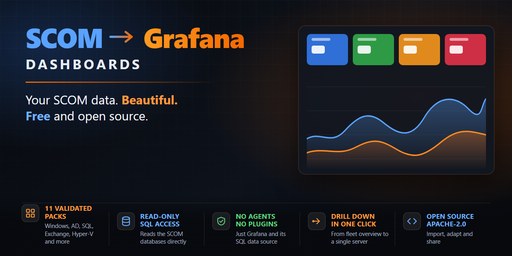
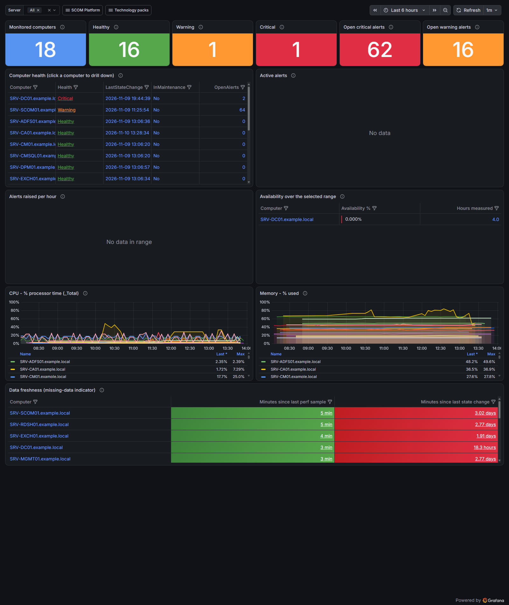
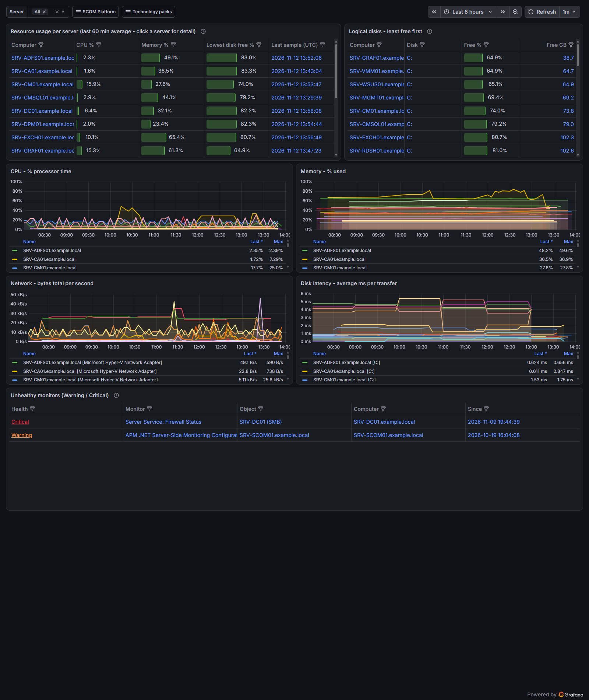
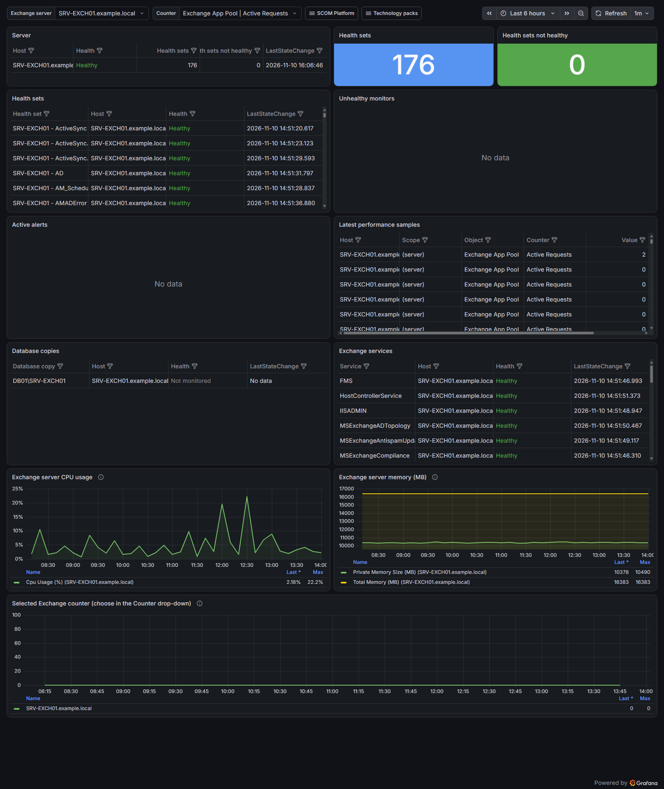

<p align="center">
  
</p>

# SCOM Grafana Dashboards


-F46800)


**Free Grafana dashboards for System Center Operations Manager (SCOM).**

Turn the data already in your SCOM databases into clear, fast, drill-down dashboards — from a whole-estate overview down to a single server. No agents, no plugins, no extra services: just Grafana, its built-in Microsoft SQL Server data source, and a **read-only** SQL account.

The goal is simple: **give everyone who needs to see SCOM data a modern dashboard, without giving them the SCOM console.**

---

## 📥 Get the dashboards

**Latest release: v0.1.4**

[**Browse the dashboards**](dashboards/) • [**Download everything (ZIP)**](../../archive/refs/heads/main.zip) • [**Installation guide**](docs/INSTALLATION.md)

**Grafana 11+ • SCOM 2022 validated • Windows Server, Active Directory, SQL Server, Exchange, Hyper-V and more**

Each dashboard is a single `.json` file you import with Grafana's built-in **Import** page — one by one, or all at once with Grafana's file provisioning. They find your SCOM SQL connections by name, so there is nothing to map. Nothing is installed on your servers.

---

## ✨ What you get

- **Enterprise overview** — monitored computers, health, open alerts, availability, CPU/memory trends and data freshness in one screen
- **Technology dashboards** with an overview and a drill-down for each — click a server name and land on its detail dashboard
- **A full alerts page**: open, closed or all alerts, filtered by severity, server and name, with a click-through to **alert details** (description, alert context, history and product knowledge, as in the SCOM console) from every alert table
- **Health, alerts and unhealthy monitors** for every technology, worst first
- **Performance trends** built from the counters SCOM actually collects — pick any collected counter from a drop-down
- **Server and counter filters** on every dashboard, and **automatic detection of your SCOM SQL connections**
- **A built-in "Technology packs" menu** at the top of each dashboard to jump between dashboards
- **Read-only by design** — only `SELECT` queries, through a read-only SQL account
- **Honest validation** — every validated dashboard was checked against real SCOM data and compared with the servers themselves
- **Apache-2.0 licensed** — use it, change it, share it

---

## 📊 Dashboards included

| Dashboards | Folder | SCOM management pack needed | Status |
|---|---|---|---|
| **SCOM Enterprise Overview**, Server Drill-down, Platform Status, **Alerts**, **Alert Details** | [`scom-core`](dashboards/scom-core/) | none | ✅ Validated |
| **Windows Server** — Fleet, Detail | [`windows-server`](dashboards/windows-server/) | Windows Server Operating System | ✅ Validated |
| **Active Directory** — Overview, DC Detail | [`active-directory`](dashboards/active-directory/) | Active Directory Domain Services | ✅ Validated |
| **SQL Server** — Overview, Instance Detail | [`sql-server`](dashboards/sql-server/) | SQL Server on Windows | ✅ Validated |
| **Exchange** — Overview, Server Detail | [`exchange`](dashboards/exchange/) | Exchange Server 2013 and above | ✅ Validated (one server) |
| **Hyper-V** — Overview, Host Detail | [`hyper-v`](dashboards/hyper-v/) | Hyper-V | ✅ Validated |
| **IIS** — Overview, Server Detail | [`iis`](dashboards/iis/) | Internet Information Services | ✅ Validated |
| **DNS Server** — Overview, Server Detail | [`dns-server`](dashboards/dns-server/) | Windows Server DNS | ✅ Validated |
| **DHCP Server** — Overview, Server Detail | [`dhcp-server`](dashboards/dhcp-server/) | Windows Server DHCP | ✅ Validated |
| **File Services** — Overview, Server Detail | [`file-services`](dashboards/file-services/) | Windows Server File Services | ✅ Validated |
| **SCOM Infrastructure** — Overview, Agents, Alert Noise | [`scom-infrastructure`](dashboards/scom-infrastructure/) | built in to SCOM | ✅ Validated |
| **Remote Access** — Overview, Server Detail | [`untested/remote-access`](dashboards/untested/remote-access/) | Remote Access | 🧪 **Untested** |
| **Failover Clustering** — Overview, Server Detail | [`untested/failover-clustering`](dashboards/untested/failover-clustering/) | Failover Cluster | 🧪 **Untested** |

Click a folder to see **screenshots of every dashboard**, the panels it contains and its management packs. Full details and known limits: [docs/PACKS.md](docs/PACKS.md).

---

## 🧪 Untested dashboards — your feedback wanted

Remote Access and Failover Clustering have **never been run against real servers** (the test lab had none). The queries are valid and the dashboards open without errors, but whether they show the right objects and numbers is **unverified**. Their titles say **(UNTESTED)**.

If you try them, please **[open an issue](../../issues/new/choose)** and tell us what worked, what didn't, and (with names removed) a screenshot. That feedback is how they become validated.

---

## 🔌 How it works

```
SCOM  ──►  OperationsManager + OperationsManagerDW (SQL Server)  ──►  Grafana (read-only SQL data source)  ──►  these dashboards
```

The dashboards read the standard SCOM database views directly: current state from `OperationsManager`, history and performance from `OperationsManagerDW`. They only ever run `SELECT` statements. Details: [docs/HOW-IT-WORKS.md](docs/HOW-IT-WORKS.md).

---

## 🖥️ Requirements

- **Grafana** 11 or later (built and tested on 13.3), with network access to the SCOM SQL Server
- **SCOM** — validated on **SCOM 2022**. SCOM 2019 and 2025 use the same database schema and are expected to work, but are **not tested**
- A **read-only** SQL account on both SCOM databases ([`deploy/sql/Grant-ReadOnly.sql`](deploy/sql/Grant-ReadOnly.sql))
- The Microsoft management pack for each technology you want (Microsoft downloads, not included)

---

## 📦 Installation

1. **Create read-only SQL access** — edit and run [`deploy/sql/Grant-ReadOnly.sql`](deploy/sql/Grant-ReadOnly.sql) on the SCOM SQL Server.
2. **Add two Microsoft SQL Server data sources** in Grafana — name them **SCOM Data Warehouse** (database `OperationsManagerDW`) and **SCOM Operational DB** (database `OperationsManager`).
3. **Import the dashboards** — *Dashboards → New → Import → Upload JSON file*, starting with `dashboards/scom-core/`. The dashboards pick up your two data sources automatically (or choose them from the drop-downs at the top). Prefer everything at once? Copy the `dashboards` folder to the Grafana server and add one config file — see [INSTALLATION.md](docs/INSTALLATION.md).
4. Repeat for the technologies you use, importing each into its own folder.

Step-by-step instructions, the import order, and what to do if something looks empty: **[docs/INSTALLATION.md](docs/INSTALLATION.md)**. Problems: **[docs/TROUBLESHOOTING.md](docs/TROUBLESHOOTING.md)**.

---

## 📸 Screenshots

Screenshots are from a small test lab. Server and domain names are masked.

### Enterprise overview


### Windows Server fleet


### Exchange server detail


---

## 🔐 Security and access

- The dashboards need **read-only** SQL access only. The provided script grants `db_datareader` and denies writes.
- Anyone who can open the dashboards can see SCOM data (server names, alerts, monitors). Use Grafana folder permissions to control who sees what.
- Want people to view dashboards **without logging in**, or sign in with **SSO**? See [docs/ACCESS.md](docs/ACCESS.md) — including the security trade-offs.

Security policy and how to report a problem privately: [SECURITY.md](SECURITY.md).

---

## 📚 Documentation

- [Installation](docs/INSTALLATION.md)
- [Dashboards and management packs](docs/PACKS.md)
- [How it works](docs/HOW-IT-WORKS.md)
- [Viewing without login, and SSO](docs/ACCESS.md)
- [Compatibility](docs/COMPATIBILITY.md)
- [Troubleshooting](docs/TROUBLESHOOTING.md)
- [Changelog](CHANGELOG.md)

---

## 🤝 Feedback and contributions

Found a bug, an empty panel, or a dashboard you'd like to see? **[Open an issue](../../issues/new/choose)** — there are templates for bug reports, feedback on the untested dashboards, and new dashboard requests. Please remove server names, domain names and addresses from anything you post.

---

## 📄 License

[Apache License 2.0](LICENSE). Microsoft, System Center, Windows Server, Exchange and SQL Server are trademarks of Microsoft Corporation. Grafana is a trademark of Grafana Labs. This project is not affiliated with or endorsed by either company ([NOTICE](NOTICE)).
