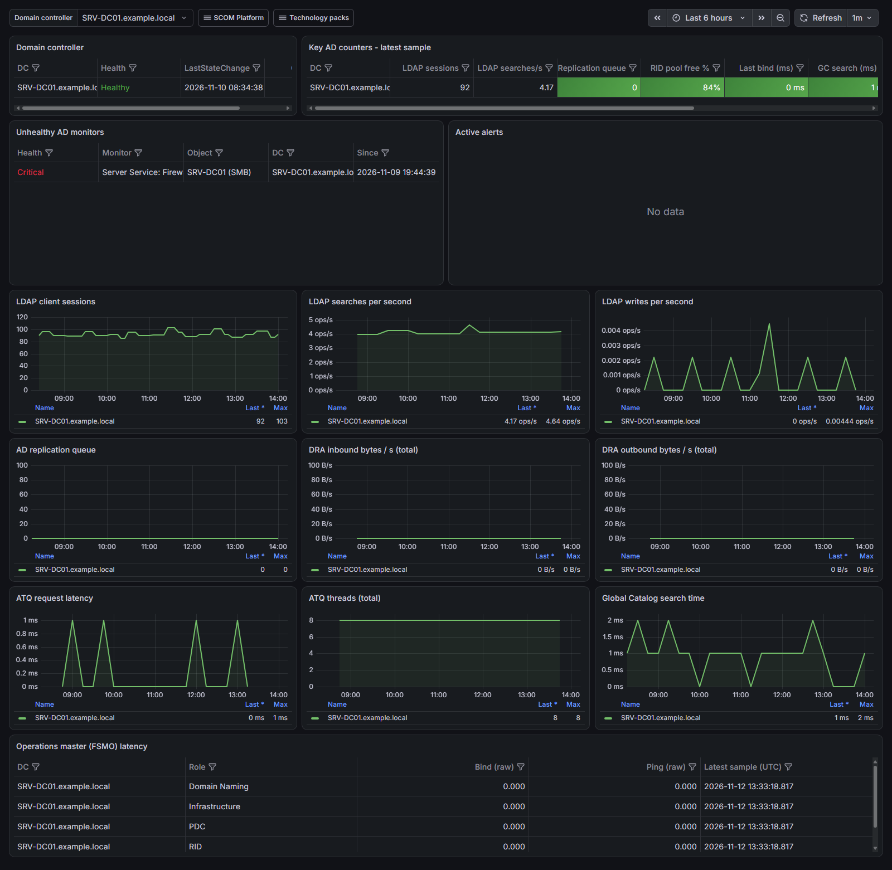
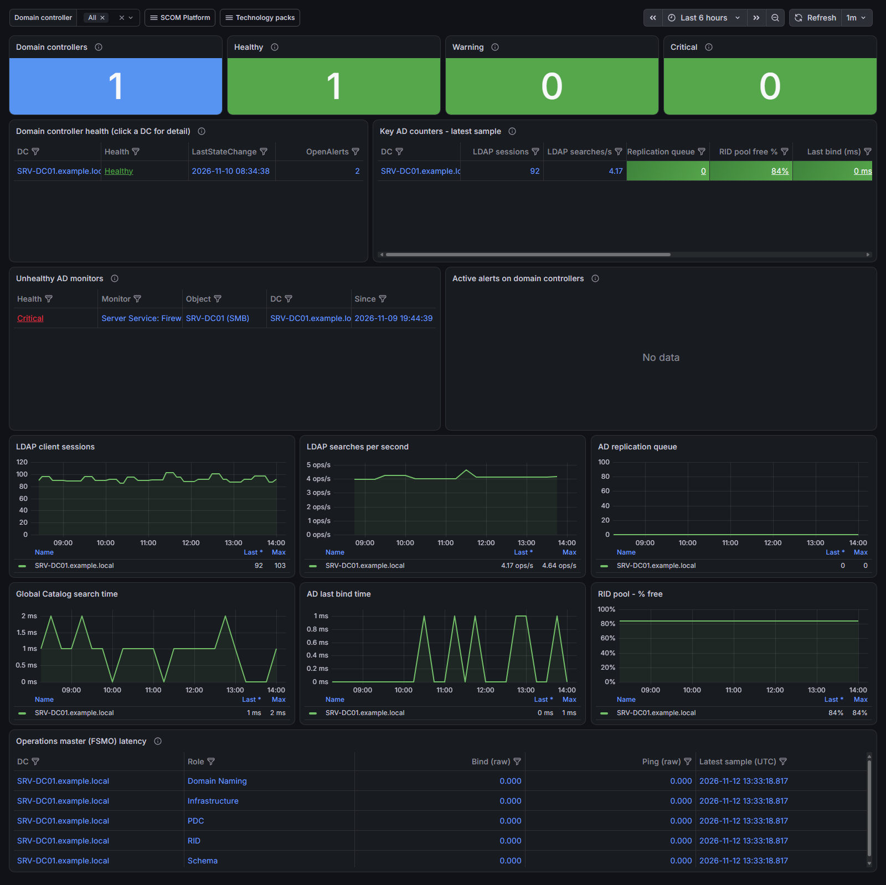

# Active Directory

Domain controller health, replication, directory database size and free space, LDAP sessions and the FSMO role holders.

**Status:** validated on SCOM 2022 against real data. See [PACKS.md](../../docs/PACKS.md) for what was checked.

## Management packs to import in SCOM

- Microsoft.Windows.Server.AD.Class.Library
- Microsoft.Windows.Server.AD.2016.Monitoring

## Active Directory - DC Detail

File: [`scom-ad-detail.json`](scom-ad-detail.json)

Panels: Domain controller · Key AD counters - latest sample · Unhealthy AD monitors · Active alerts · LDAP client sessions · LDAP searches per second · LDAP writes per second · AD replication queue · DRA inbound bytes / s (total) · DRA outbound bytes / s (total) · ATQ request latency · ATQ threads (total) · Global Catalog search time · Operations master (FSMO) latency

## Active Directory - Overview

File: [`scom-ad-overview.json`](scom-ad-overview.json)

Panels: Domain controllers · Healthy · Warning · Critical · Domain controller health (click a DC for detail) · Key AD counters - latest sample · Unhealthy AD monitors · Active alerts on domain controllers · LDAP client sessions · LDAP searches per second · AD replication queue · Global Catalog search time · AD last bind time · RID pool - % free · Operations master (FSMO) latency

## Known limits

- Validated against one domain; multi-domain forests and read-only domain controllers were not exercised.

## Import

*Dashboards → New → Import → Upload dashboard JSON file*, pick a folder, and import — the dashboard finds your SCOM SQL connections by name (or choose them from the two drop-downs at the top left). Import all folders at once with file provisioning: [INSTALLATION.md](../../docs/INSTALLATION.md). Screenshots are from a small test lab with server and domain names masked.
