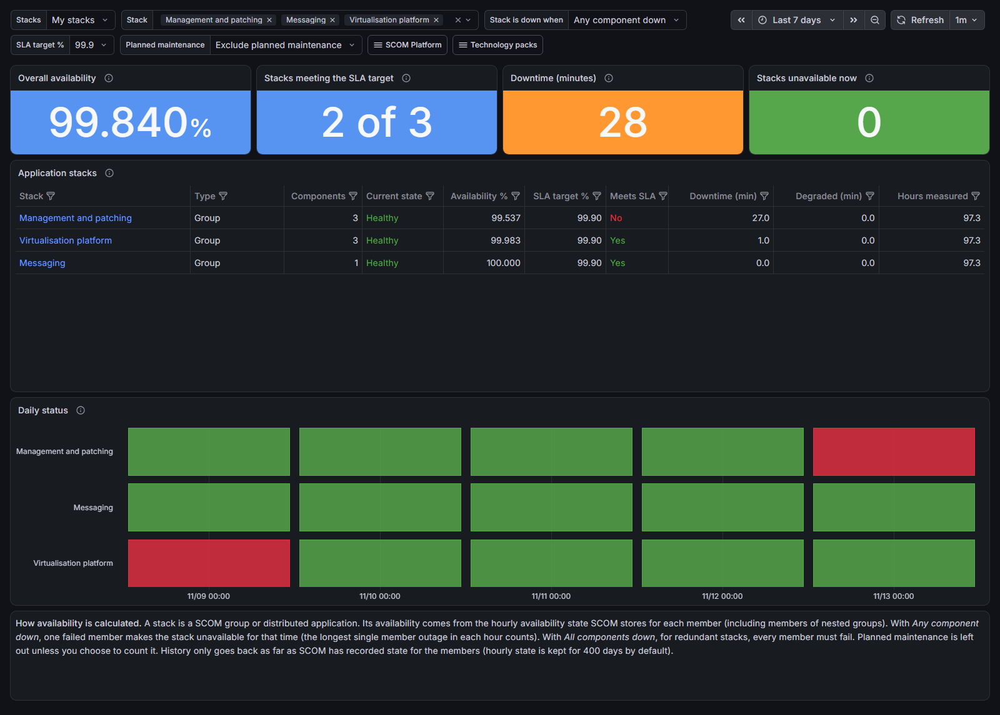
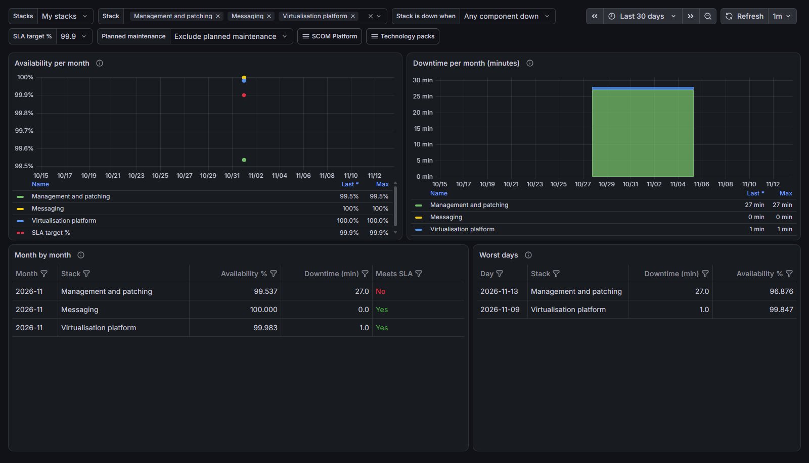
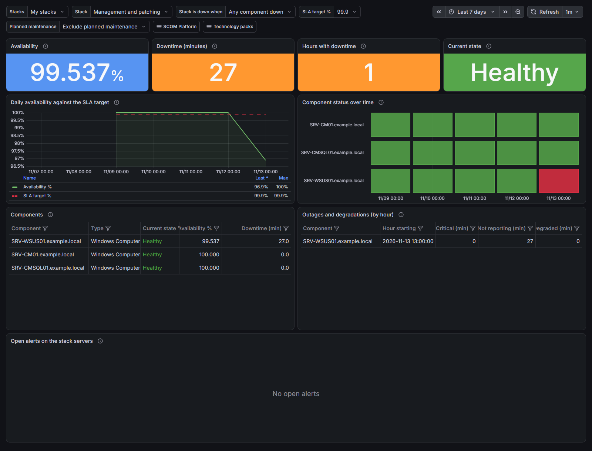

# Availability

Availability of your application stacks (SCOM groups and distributed applications): current state, availability against an SLA target, downtime, component status, outages, open alerts and a month-by-month report.

**Status:** validated on SCOM 2022 against real data. See [PACKS.md](../../docs/PACKS.md) for what was checked.

## Management packs to import in SCOM

- None. You need at least one group or distributed application in SCOM, with monitored servers as members. Availability comes from the availability monitors of the members, which every Windows computer has. **How to create a stack and what the drop-downs do: [AVAILABILITY.md](../../docs/AVAILABILITY.md).**

## Availability - Overview

File: [`scom-avail-overview.json`](scom-avail-overview.json)

Panels: Overall availability · Stacks meeting the SLA target · Downtime (minutes) · Stacks unavailable now · Application stacks · Daily status

## Availability - Monthly Report

File: [`scom-avail-report.json`](scom-avail-report.json)

Panels: Availability per month · Downtime per month (minutes) · Month by month · Worst days

## Availability - Stack Detail

File: [`scom-avail-stack.json`](scom-avail-stack.json)

Panels: Availability · Downtime (minutes) · Hours with downtime · Current state · Daily availability against the SLA target · Component status over time · Components · Outages and degradations (by hour) · Open alerts on the stack servers

## Known limits

- A stack's availability is calculated from its members' hourly availability states, not from a health model of its own, so it needs monitored members. A stack with none shows no data.
- History starts when the members were first monitored, and SCOM keeps hourly state for 400 days by default.
- Tested in the lab with groups of Windows computers, including a real outage. Distributed applications and nested groups were not exercised.

## Import

*Dashboards → New → Import → Upload dashboard JSON file*, pick a folder, and import — the dashboard finds your SCOM SQL connections by name (or choose them from the two drop-downs at the top left). Import all folders at once with file provisioning: [INSTALLATION.md](../../docs/INSTALLATION.md). Screenshots are from a small test lab with server and domain names masked.
