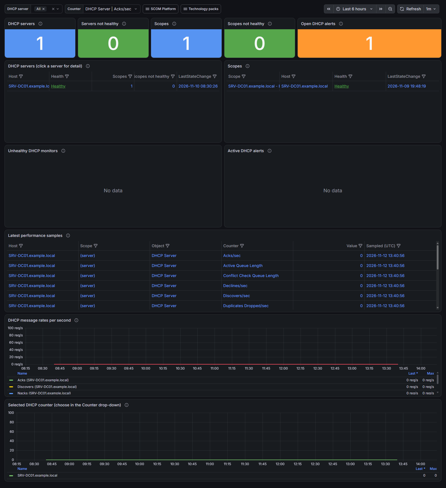
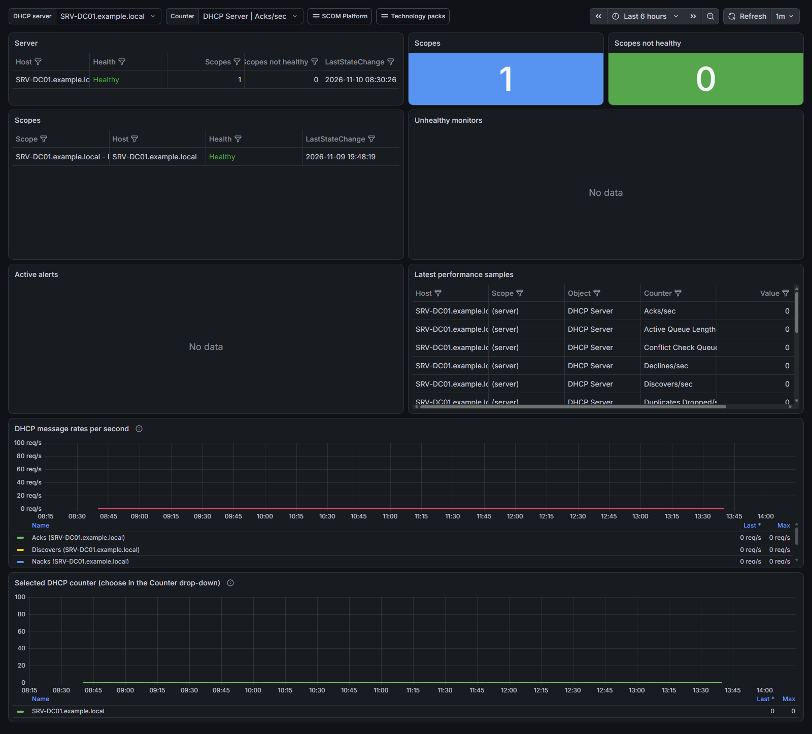

# DHCP Server

DHCP server and IPv4 scope health with message rates (Discover, Offer, Request, Ack, Nack).

**Status:** validated on SCOM 2022 against real data. See [PACKS.md](../../docs/PACKS.md) for what was checked.

## Management packs to import in SCOM

- Microsoft.Windows.DHCPServer.Library
- Microsoft.Windows.DHCPServer.2016

## DHCP - Overview

File: [`scom-dhcp-overview.json`](scom-dhcp-overview.json)

Panels: DHCP servers · Servers not healthy · Scopes · Scopes not healthy · Open DHCP alerts · DHCP servers (click a server for detail) · Unhealthy DHCP monitors · Active DHCP alerts · Latest performance samples · DHCP message rates per second · Selected DHCP counter (choose in the Counter drop-down)

## DHCP - Server Detail

File: [`scom-dhcp-server.json`](scom-dhcp-server.json)

Panels: Server · Scopes · Scopes not healthy · Unhealthy monitors · Active alerts · Latest performance samples · DHCP message rates per second · Selected DHCP counter (choose in the Counter drop-down)

## Known limits

- One DHCP server tested; failover and IPv6 scopes were not exercised.
- Scope address utilisation is not charted: the management pack exposes it only as monitor state.

## Import

*Dashboards → New → Import → Upload dashboard JSON file*, pick a folder, and import — the dashboard finds your SCOM SQL connections by name (or choose them from the two drop-downs at the top left). Import all folders at once with file provisioning: [INSTALLATION.md](../../docs/INSTALLATION.md). Screenshots are from a small test lab with server and domain names masked.
