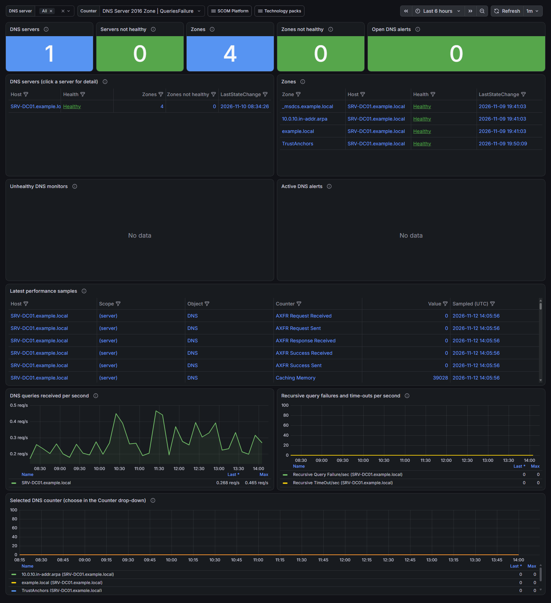
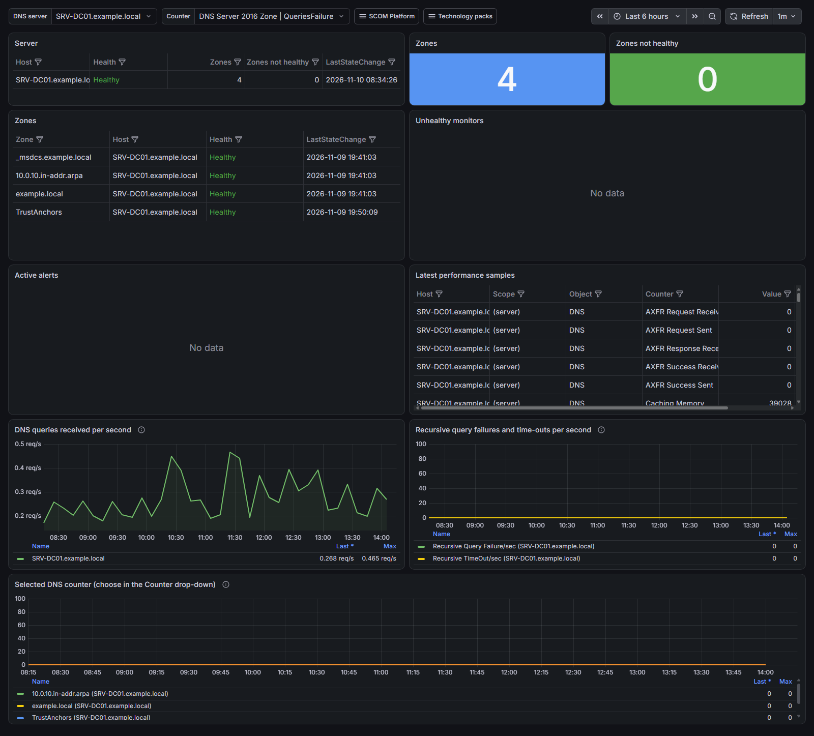

# DNS Server

DNS server and zone health, query rates and recursive failures.

**Status:** validated on SCOM 2022 against real data. See [PACKS.md](../../docs/PACKS.md) for what was checked.

## Management packs to import in SCOM

- Microsoft.Windows.DNSServer.2016

## DNS - Overview

File: [`scom-dns-overview.json`](scom-dns-overview.json)

Panels: DNS servers · Servers not healthy · Zones · Zones not healthy · Open DNS alerts · DNS servers (click a server for detail) · Unhealthy DNS monitors · Active DNS alerts · Latest performance samples · DNS queries received per second · Recursive query failures and time-outs per second · Selected DNS counter (choose in the Counter drop-down)

## DNS - Server Detail

File: [`scom-dns-server.json`](scom-dns-server.json)

Panels: Server · Zones · Zones not healthy · Unhealthy monitors · Active alerts · Latest performance samples · DNS queries received per second · Recursive query failures and time-outs per second · Selected DNS counter (choose in the Counter drop-down)

## Known limits

- Validated on one DNS server; forwarders and DNSSEC monitors were not exercised.

## Import

*Dashboards → New → Import → Upload dashboard JSON file*, pick a folder, and import — the dashboard finds your SCOM SQL connections by name (or choose them from the two drop-downs at the top left). Import all folders at once with file provisioning: [INSTALLATION.md](../../docs/INSTALLATION.md). Screenshots are from a small test lab with server and domain names masked.
