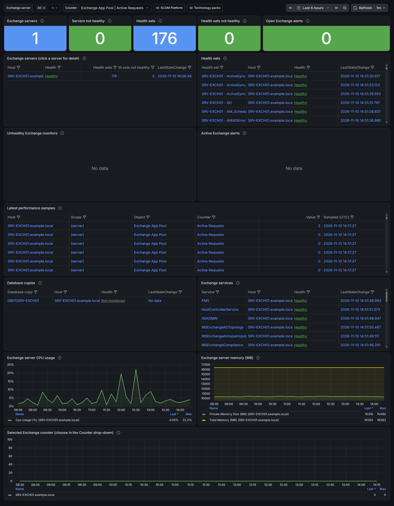
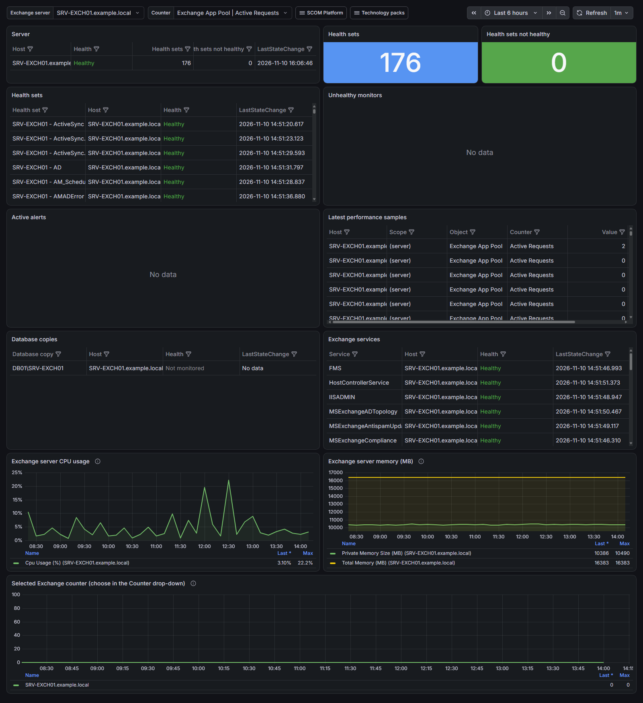

# Exchange

Exchange server health through Managed Availability health sets, mailbox database copies, Exchange services, and CPU and memory.

**Status:** validated on SCOM 2022 against real data. See [PACKS.md](../../docs/PACKS.md) for what was checked.

## Management packs to import in SCOM

- Microsoft.Exchange.15 (System Center Management Pack for Exchange 2013 and above)

## Exchange - Overview

File: [`scom-ex-overview.json`](scom-ex-overview.json)

Panels: Exchange servers · Servers not healthy · Health sets · Health sets not healthy · Open Exchange alerts · Exchange servers (click a server for detail) · Unhealthy Exchange monitors · Active Exchange alerts · Latest performance samples · Database copies · Exchange services · Exchange server CPU usage · Exchange server memory (MB) · Selected Exchange counter (choose in the Counter drop-down)

## Exchange - Server Detail

File: [`scom-ex-server.json`](scom-ex-server.json)

Panels: Server · Health sets · Health sets not healthy · Unhealthy monitors · Active alerts · Latest performance samples · Database copies · Exchange services · Exchange server CPU usage · Exchange server memory (MB) · Selected Exchange counter (choose in the Counter drop-down)

## Known limits

- Needs agent proxy enabled on the Exchange servers' agents.
- Validated on one Exchange 2019 server with one database; DAG and mail flow were not exercised.
- SCOM's Exchange service monitor samples every 15 minutes and needs 3 samples, so a stopped service takes 30-45 minutes to show.
- The database copy is listed but SCOM gives it no health state in the test lab (shown as "Not monitored").

## Import

*Dashboards → New → Import → Upload dashboard JSON file*, pick a folder, and import — the dashboard finds your SCOM SQL connections by name (or choose them from the two drop-downs at the top left). Import all folders at once with file provisioning: [INSTALLATION.md](../../docs/INSTALLATION.md). Screenshots are from a small test lab with server and domain names masked.
