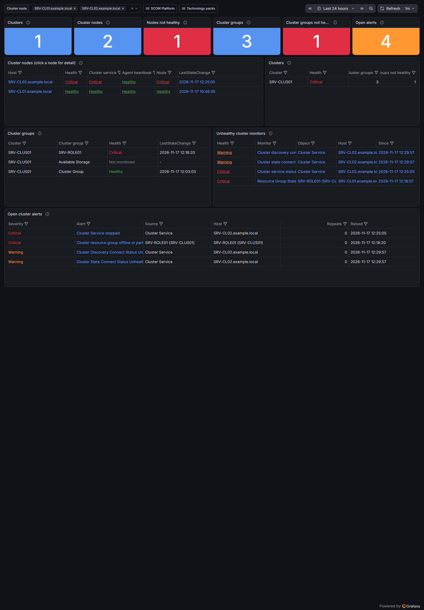
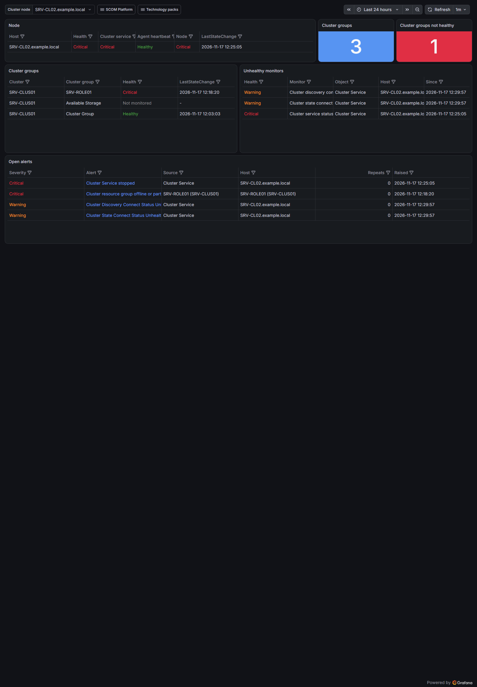

# Failover Clustering

Failover cluster health: the cluster nodes (node, Cluster Service and agent heartbeat), the clusters and their cluster groups (clustered roles), unhealthy monitors and open alerts.

**Status:** validated on SCOM 2022 against real data. See [PACKS.md](../../docs/PACKS.md) for what was checked.

## Management packs to import in SCOM

- Microsoft.Windows.Cluster.Library
- Microsoft.Windows.Cluster.Management.Library
- Microsoft.Windows.Cluster.Management.Monitoring
- For Windows Server 2016 and later clusters: Microsoft.Windows.2016.Cluster.Management.Library and Microsoft.Windows.2016.Cluster.Management.Monitoring

## Failover Clustering - Overview

File: [`scom-cl-overview.json`](scom-cl-overview.json)

Panels: Clusters · Cluster nodes · Nodes not healthy · Cluster groups · Cluster groups not healthy · Open alerts · Cluster nodes (click a node for detail) · Unhealthy cluster monitors · Open cluster alerts

## Failover Clustering - Node Detail

File: [`scom-cl-server.json`](scom-cl-server.json)

Panels: Node · Cluster groups · Cluster groups not healthy · Unhealthy monitors · Open alerts

## Known limits

- Tested on one two-node Windows Server 2025 cluster with a file-share witness on SCOM 2022. A stopped cluster service turned the node and its Cluster Service red and raised alerts; a powered-off node turned its agent heartbeat red; a clustered role taken offline turned its cluster group and the cluster red and raised an alert. The screenshots show a stopped cluster service on one node and an offline clustered role at the same time.
- Not tested: cluster disks and Cluster Shared Volumes (the lab host cannot share virtual disks), cluster resources and networks, several clusters, and clusters on Windows Server 2016 and 2019.
- A node that has been down for a while stops being listed by SCOM as a cluster Node object. The dashboards also list every host that runs a Cluster Service, so a failed node stays visible.
- The management pack collects no performance counters, so there are no performance panels. Alerts on the cluster or its groups belong to no single node, so they are listed whichever nodes are selected.

## Import

*Dashboards → New → Import → Upload dashboard JSON file*, pick a folder, and import — the dashboard finds your SCOM SQL connections by name (or choose them from the two drop-downs at the top left). Import all folders at once with file provisioning: [INSTALLATION.md](../../docs/INSTALLATION.md). Screenshots are from a small test lab with server and domain names masked.
