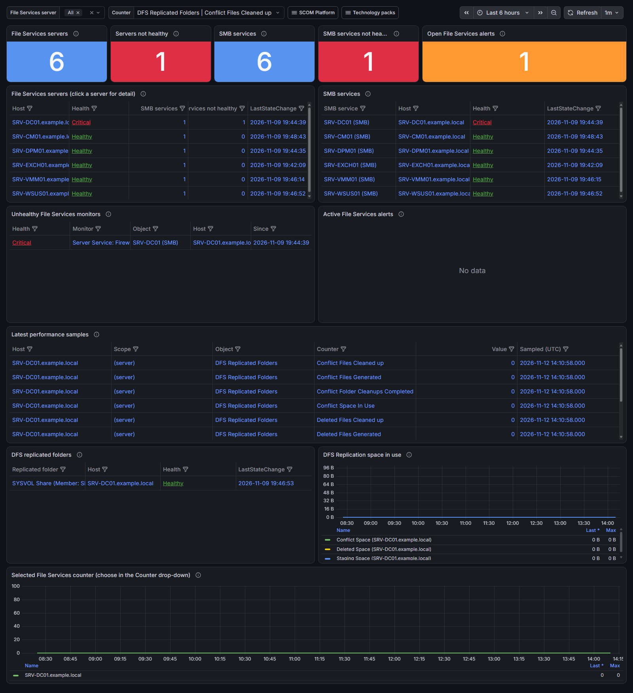
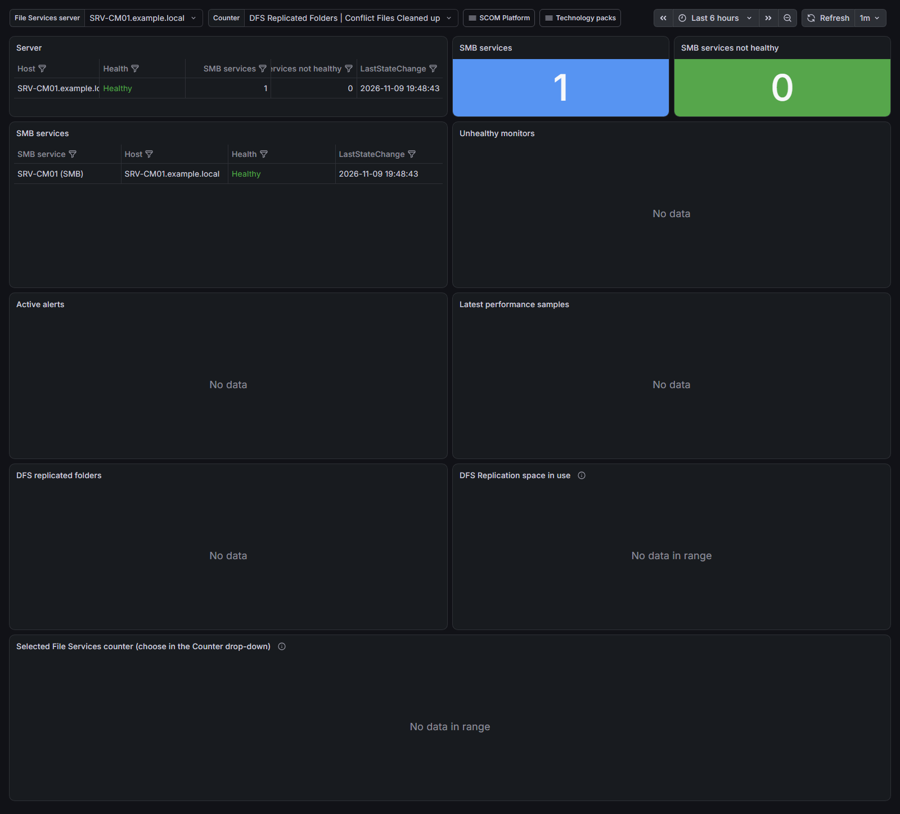

# File Services

File server, SMB service and DFS Replication health with DFS counters.

**Status:** validated on SCOM 2022 against real data. See [PACKS.md](../../docs/PACKS.md) for what was checked.

## Management packs to import in SCOM

- Microsoft.Windows.FileServices.2016
- Microsoft.Windows.FileServer.DFSR.2016

## File Services - Overview

File: [`scom-fs-overview.json`](scom-fs-overview.json)

Panels: File Services servers · Servers not healthy · SMB services · SMB services not healthy · Open File Services alerts · File Services servers (click a server for detail) · Unhealthy File Services monitors · Active File Services alerts · Latest performance samples · DFS replicated folders · DFS Replication space in use · Selected File Services counter (choose in the Counter drop-down)

## File Services - Server Detail

File: [`scom-fs-server.json`](scom-fs-server.json)

Panels: Server · SMB services · SMB services not healthy · Unhealthy monitors · Active alerts · Latest performance samples · DFS replicated folders · DFS Replication space in use · Selected File Services counter (choose in the Counter drop-down)

## Known limits

- Stopping the Server (LanmanServer) service raised no monitor in SCOM during testing, so fault detection was not demonstrated.
- DFS counters exist only on DFS Replication members.

## Import

*Dashboards → New → Import → Upload dashboard JSON file*, pick a folder, and import — the dashboard finds your SCOM SQL connections by name (or choose them from the two drop-downs at the top left). Import all folders at once with file provisioning: [INSTALLATION.md](../../docs/INSTALLATION.md). Screenshots are from a small test lab with server and domain names masked.
