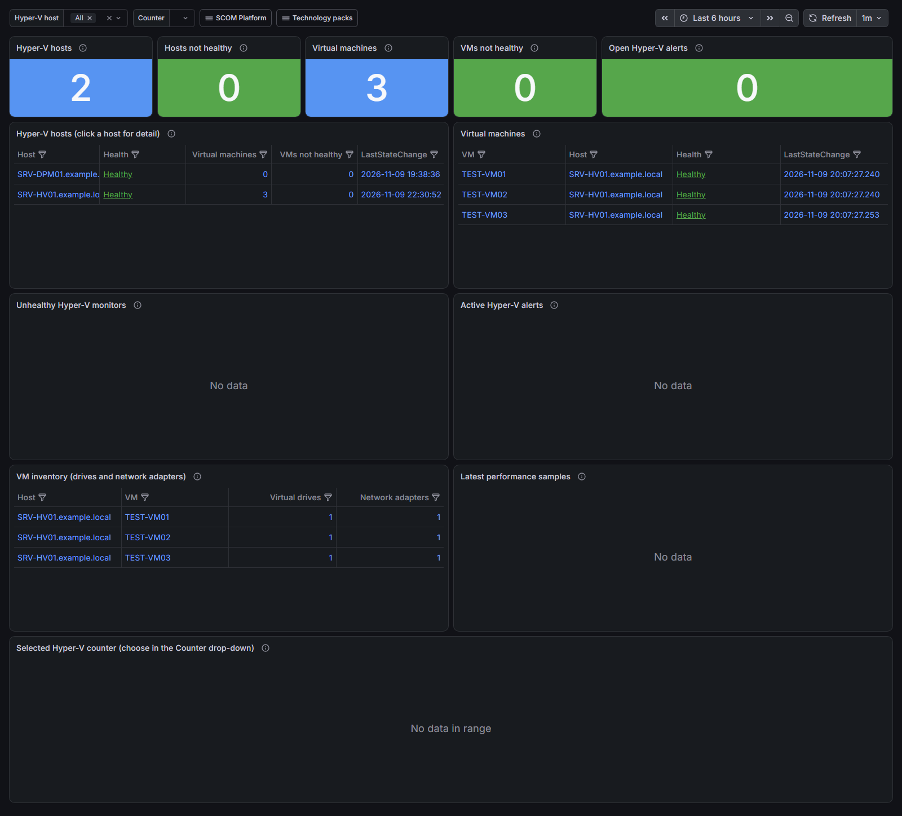

# Hyper-V

Hyper-V hosts, virtual machines, virtual drives and network adapters with health, alerts and counters.

**Status:** validated on SCOM 2022 against real data. See [PACKS.md](../../docs/PACKS.md) for what was checked.

## Management packs to import in SCOM

- Microsoft.Windows.HyperV.Library
- Microsoft.Windows.HyperV.Discovery
- Microsoft.Windows.HyperV.Monitoring

## Hyper-V - Host Detail

File: [`scom-hv-host.json`](scom-hv-host.json)

Panels: Host · Virtual machines · VMs not healthy · VM inventory · Unhealthy monitors · Active alerts · Latest performance samples · Selected Hyper-V counter (choose in the Counter drop-down)

## Hyper-V - Overview

File: [`scom-hv-overview.json`](scom-hv-overview.json)

Panels: Hyper-V hosts · Hosts not healthy · Virtual machines · VMs not healthy · Open Hyper-V alerts · Hyper-V hosts (click a host for detail) · Unhealthy Hyper-V monitors · Active Hyper-V alerts · VM inventory (drives and network adapters) · Latest performance samples · Selected Hyper-V counter (choose in the Counter drop-down)

## Known limits

- The performance-counter panels stayed untested until SCOM collected data in the lab.

## Import

*Dashboards → New → Import → Upload dashboard JSON file*, pick a folder, and import — the dashboard finds your SCOM SQL connections by name (or choose them from the two drop-downs at the top left). Import all folders at once with file provisioning: [INSTALLATION.md](../../docs/INSTALLATION.md). Screenshots are from a small test lab with server and domain names masked.
