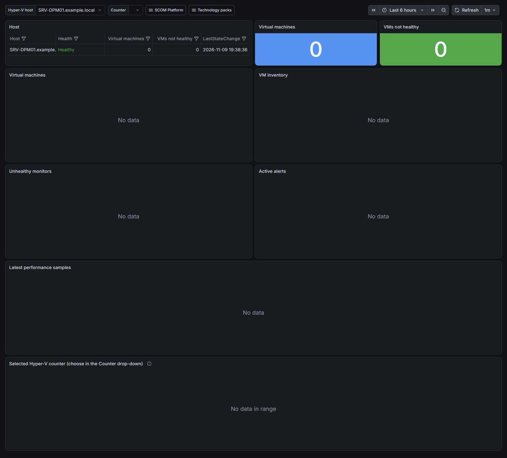
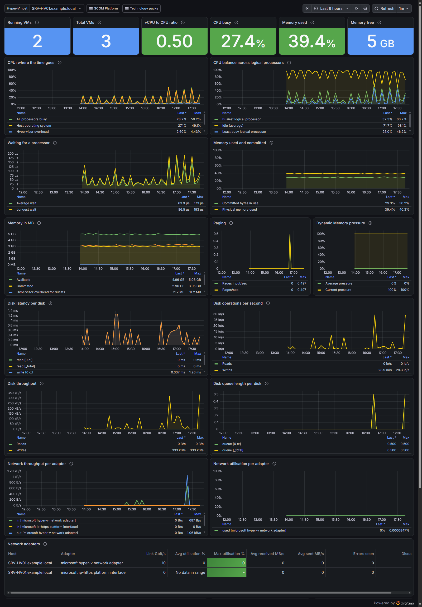
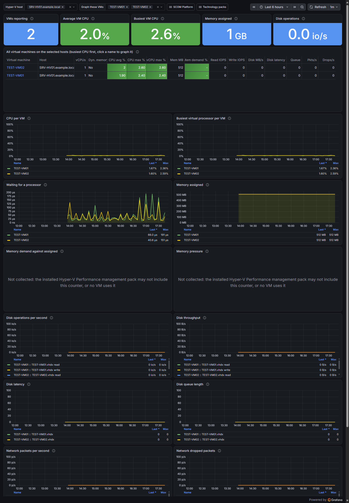

# Hyper-V

Hyper-V hosts, virtual machines, virtual drives and network adapters with health, alerts and counters, plus host and virtual machine performance (CPU, memory, storage, network, capacity) from the Hyper-V Performance (Community) management pack.

**Status:** validated on SCOM 2022 against real data. See [PACKS.md](../../docs/PACKS.md) for what was checked.

## Management packs to import in SCOM

- Microsoft.Windows.HyperV.Library
- Microsoft.Windows.HyperV.Discovery
- Microsoft.Windows.HyperV.Monitoring
- For the two **Hyper-V Performance** dashboards only: Community.HyperV.Performance (Hyper-V Performance (Community)). Without it those two dashboards are empty; the others do not need it.

## Hyper-V - Host Detail

File: [`scom-hv-host.json`](scom-hv-host.json)

Panels: Host · Virtual machines · VMs not healthy · VM inventory · Unhealthy monitors · Active alerts · Latest performance samples · Selected Hyper-V counter (choose in the Counter drop-down)

## Hyper-V - Overview

File: [`scom-hv-overview.json`](scom-hv-overview.json)

Panels: Hyper-V hosts · Hosts not healthy · Virtual machines · VMs not healthy · Open Hyper-V alerts · Hyper-V hosts (click a host for detail) · Unhealthy Hyper-V monitors · Active Hyper-V alerts · VM inventory (drives and network adapters) · Latest performance samples · Selected Hyper-V counter (choose in the Counter drop-down)

## Hyper-V Performance - Host

File: [`scom-hvp-host.json`](scom-hvp-host.json)

Panels: Running VMs · Total VMs · vCPU to CPU ratio · CPU busy · Memory used · Memory free · CPU: where the time goes · CPU balance across logical processors · Waiting for a processor · Memory used and committed · Memory in MB · Paging · Dynamic Memory pressure · Disk latency per disk · Disk operations per second · Disk throughput · Disk queue length per disk · Network throughput per adapter · Network utilisation per adapter · Network adapters · Volumes · Virtual switch throughput · Virtual switch dropped packets · Virtual machines by state · Processors: assigned against available · Memory: assigned to VMs against installed

## Hyper-V Performance - Virtual Machines

File: [`scom-hvp-vm.json`](scom-hvp-vm.json)

Panels: VMs reporting · Average VM CPU · Busiest VM CPU · Memory assigned · Disk operations · All virtual machines on the selected hosts (busiest CPU first, click a name to graph it) · CPU per VM · Busiest virtual processor per VM · Waiting for a processor · Memory demand against assigned · Memory pressure · Disk operations per second · Disk throughput · Disk latency · Disk queue length · Network packets per second · Network dropped packets · Network throughput · Virtual disk errors

## Performance dashboards

Hyper-V Performance - Host and Hyper-V Performance - Virtual Machines. What each panel means, how to pick VMs for the graphs, and what was and was not tested: [HYPERV-PERFORMANCE.md](../../docs/HYPERV-PERFORMANCE.md).

## Known limits

- The performance-counter panels stayed untested until SCOM collected data in the lab.
- The performance dashboards were tested on a lab host with two nearly idle VMs: thresholds and busy-host graphs have not been seen under load. VM memory demand and pressure and VM network bytes are not collected by the lab's version of the management pack, so those three panels show 'Not collected'.

## Import

*Dashboards → New → Import → Upload dashboard JSON file*, pick a folder, and import — the dashboard finds your SCOM SQL connections by name (or choose them from the two drop-downs at the top left). Import all folders at once with file provisioning: [INSTALLATION.md](../../docs/INSTALLATION.md). Screenshots are from a small test lab with server and domain names masked.
