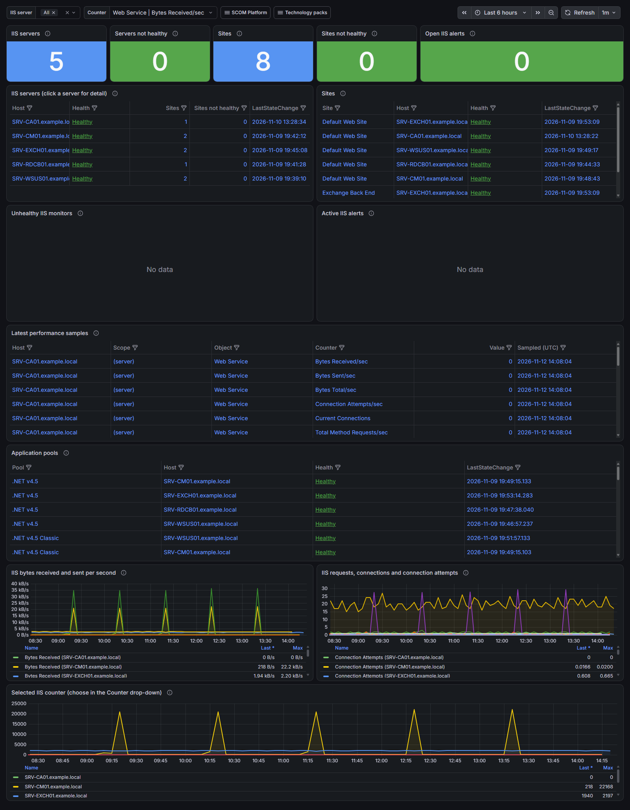
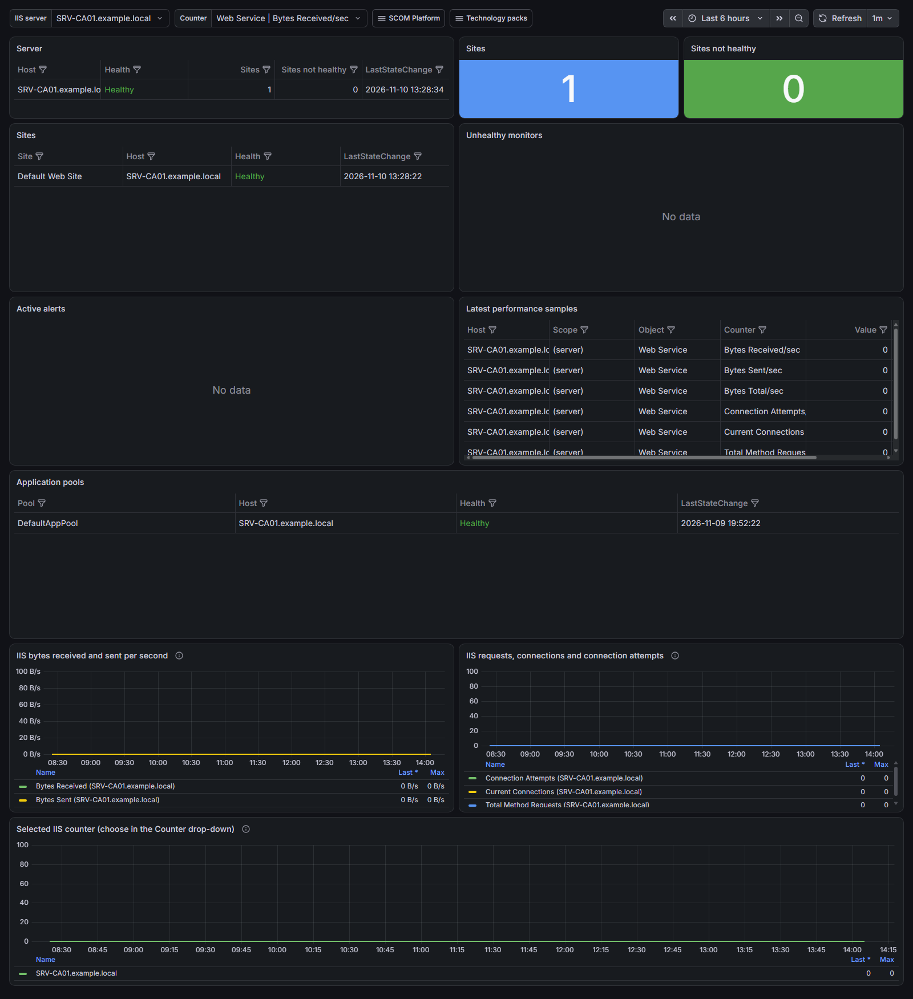

# IIS

IIS server, website and application pool health with traffic, request and connection charts.

**Status:** validated on SCOM 2022 against real data. See [PACKS.md](../../docs/PACKS.md) for what was checked.

## Management packs to import in SCOM

- Microsoft.Windows.InternetInformationServices.2016

## IIS - Overview

File: [`scom-iis-overview.json`](scom-iis-overview.json)

Panels: IIS servers · Servers not healthy · Sites · Sites not healthy · Open IIS alerts · IIS servers (click a server for detail) · Unhealthy IIS monitors · Active IIS alerts · Latest performance samples · Application pools · IIS bytes received and sent per second · IIS requests, connections and connection attempts · Selected IIS counter (choose in the Counter drop-down)

## IIS - Server Detail

File: [`scom-iis-server.json`](scom-iis-server.json)

Panels: Server · Sites · Sites not healthy · Unhealthy monitors · Active alerts · Latest performance samples · Application pools · IIS bytes received and sent per second · IIS requests, connections and connection attempts · Selected IIS counter (choose in the Counter drop-down)

## Known limits

- FTP and certificate monitors were not exercised.

## Import

*Dashboards → New → Import → Upload dashboard JSON file*, pick a folder, and import — the dashboard finds your SCOM SQL connections by name (or choose them from the two drop-downs at the top left). Import all folders at once with file provisioning: [INSTALLATION.md](../../docs/INSTALLATION.md). Screenshots are from a small test lab with server and domain names masked.
