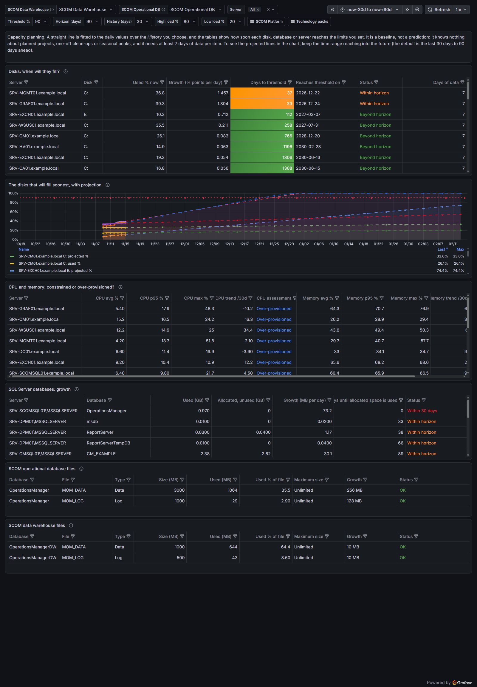
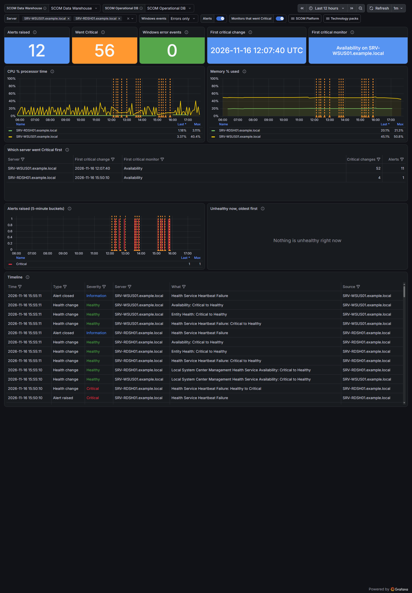
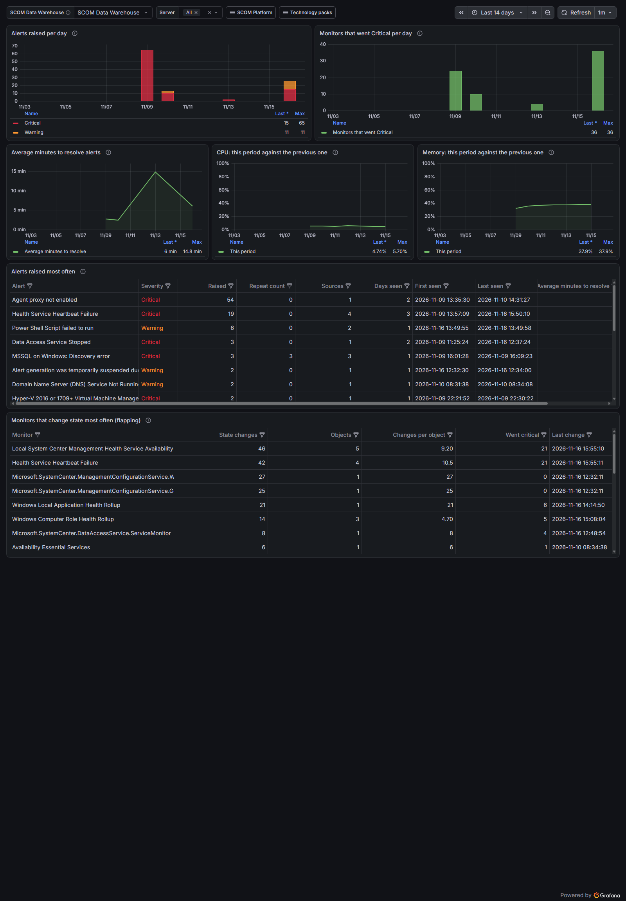

# Insights

Root cause hints, capacity planning and trends from the data SCOM already holds: a per-server timeline of alerts, health changes and events, forecasts of when disks, databases and SCOM's own files will fill, over-provisioned and constrained servers, and trends in alerts and flapping monitors.

**Status:** validated on SCOM 2022 against real data. See [PACKS.md](../../docs/PACKS.md) for what was checked.

## Management packs to import in SCOM

- None. Uses the data SCOM already collects: alerts, monitor state, Windows events and the Windows Server and SQL Server performance counters (only the counters your management packs collect are shown).

## Insights - Capacity Planning

File: [`scom-ins-capacity.json`](scom-ins-capacity.json)

Panels: Disks: when will they fill? · The disks that will fill soonest, with projection · CPU and memory: constrained or over-provisioned? · SQL Server databases: growth · SCOM operational database files · SCOM data warehouse files

## Insights - Server Timeline

File: [`scom-ins-timeline.json`](scom-ins-timeline.json)

Panels: Alerts raised · Went Critical · Windows error events · First critical change · First critical monitor · CPU % processor time · Memory % used · Which server went Critical first · Alerts raised (5-minute buckets) · Unhealthy now, oldest first · Timeline

## Insights - Trends

File: [`scom-ins-trends.json`](scom-ins-trends.json)

Panels: Alerts raised per day · Monitors that went Critical per day · Average minutes to resolve alerts · CPU: this period against the previous one · Memory: this period against the previous one · Alerts raised most often · Monitors that change state most often (flapping)

## How to use it

Full guide with what each panel means, how the forecasts are calculated and their limits: [INSIGHTS.md](../../docs/INSIGHTS.md).

## Known limits

- Forecasts are a straight-line baseline fitted to the history you choose; they need at least 7 days of data and know nothing about planned changes or seasonal peaks.
- The timeline shows what happened first, which is where to start looking; it does not prove the cause.
- Tested on a young SCOM 2022 lab (about 9 days of history). Not tested with a minimum-rights SQL account, on a large estate, or with long histories.

## Import

*Dashboards → New → Import → Upload dashboard JSON file*, pick a folder, and import — the dashboard finds your SCOM SQL connections by name (or choose them from the two drop-downs at the top left). Import all folders at once with file provisioning: [INSTALLATION.md](../../docs/INSTALLATION.md). Screenshots are from a small test lab with server and domain names masked.
