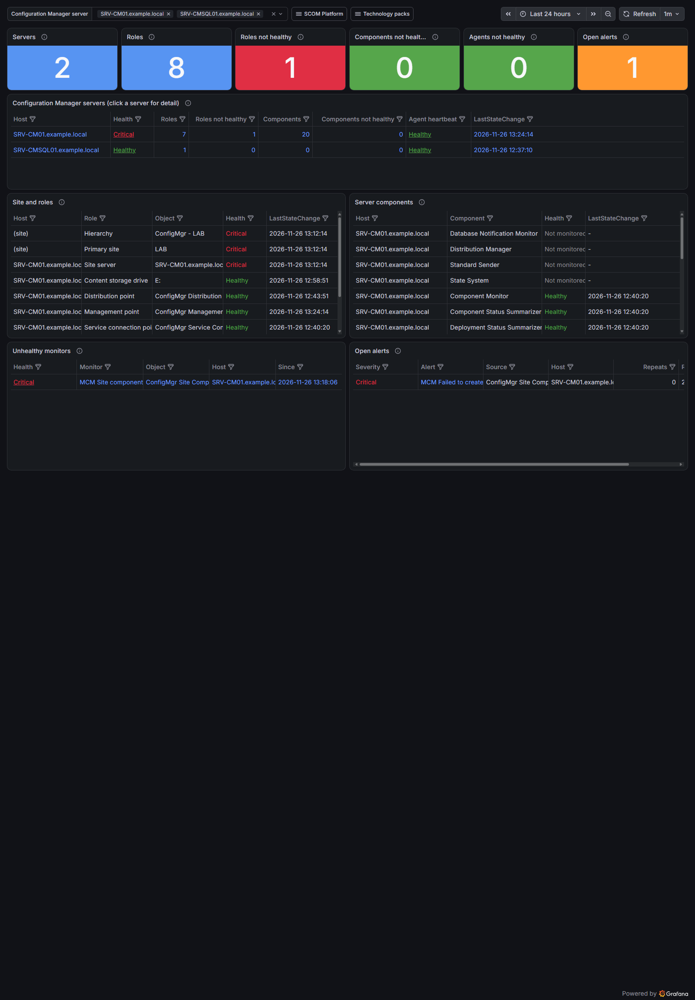
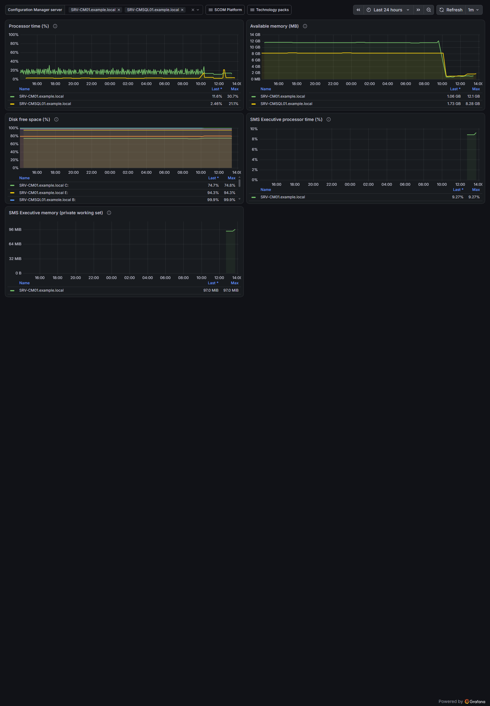
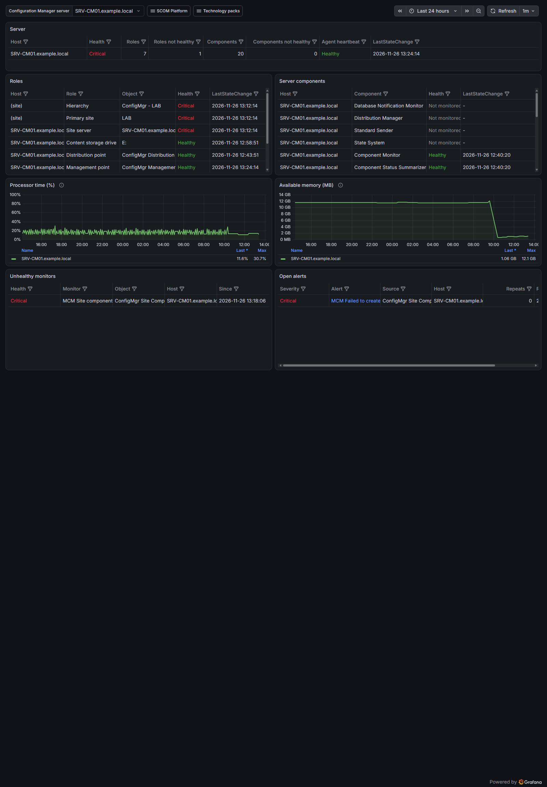

# SCCM Monitoring (SCOM)

Microsoft Configuration Manager as SCOM sees it: the servers that run site roles and server components, their health, unhealthy monitors, open alerts and server performance, from the MECM management pack.

**Status:** validated on SCOM 2022 against real data. See [PACKS.md](../../docs/PACKS.md) for what was checked.

## Management packs to import in SCOM

- Microsoft Configuration Manager (MECM / MCM) management pack, tested at version 5.0.2303.2
- Windows Server operating system management pack (for the processor, memory and disk panels)

## SCCM Monitoring - Overview

File: [`scom-cmm-overview.json`](scom-cmm-overview.json)

Panels: Servers · Roles · Roles not healthy · Components not healthy · Agents not healthy · Open alerts · Configuration Manager servers (click a server for detail) · Site and roles · Server components · Unhealthy monitors

## SCCM Monitoring - Performance

File: [`scom-cmm-perf.json`](scom-cmm-perf.json)

Panels: Processor time (%) · Available memory (MB) · Disk free space (%) · SMS Executive processor time (%) · SMS Executive memory (private working set)

## SCCM Monitoring - Server Detail

File: [`scom-cmm-server.json`](scom-cmm-server.json)

Panels: Server · Roles · Server components · Processor time (%) · Available memory (MB) · Unhealthy monitors · Open alerts

For clients, patching, deployments and inventory use the separate **SCCM** folder, which reads the site database. See [SCCM.md](../../docs/SCCM.md).

## Known limits

- Tested on one primary site with the site database on a separate server, on SCOM 2022 with management pack 5.0.2303.2. Roles and the 20 server components are listed with their health.
- The management pack collects very little performance data by default: only the SMSExec processor and memory counters are on. Its other performance collection rules (message queues, inbox backlogs, the Configuration Manager counters) are disabled, so those are not charted unless you enable them. No override was made in the lab.
- Several of the management pack's monitors are disabled by default (for example the IIS and WSUS service monitors on the site roles) and show as Not monitored.
- Not tested: a central administration site, secondary sites, several management points or distribution points, distribution points on their own servers.
- Configuration Manager component errors in the status messages are not monitored by the management pack, so they do not appear here; the SCCM folder shows them from the site database.

## Import

*Dashboards → New → Import → Upload dashboard JSON file*, pick a folder, and import — the dashboard finds your SCOM SQL connections by name (or choose them from the two drop-downs at the top left). Import all folders at once with file provisioning: [INSTALLATION.md](../../docs/INSTALLATION.md). Screenshots are from a small test lab with server and domain names masked.
