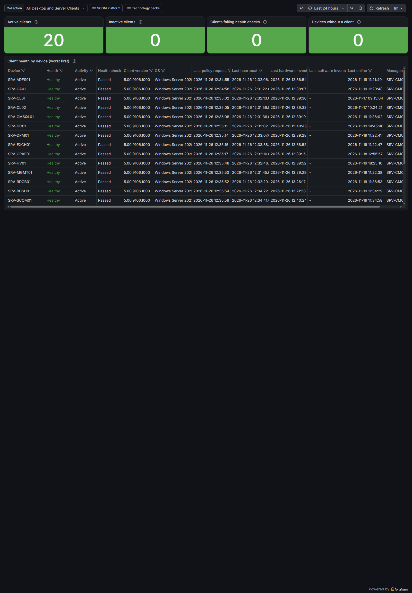
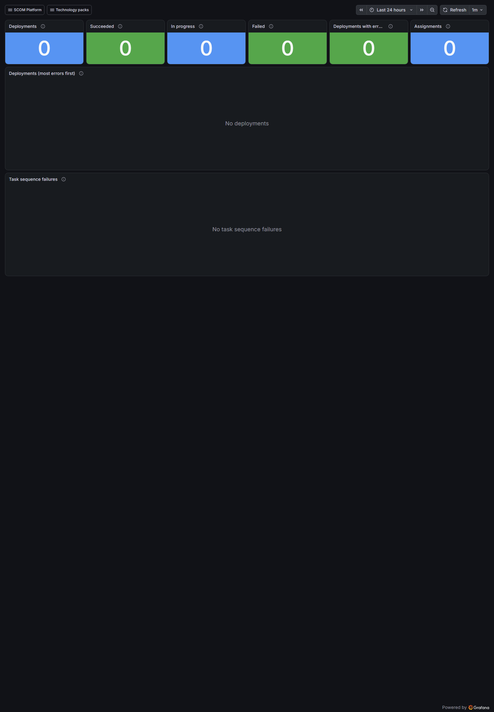
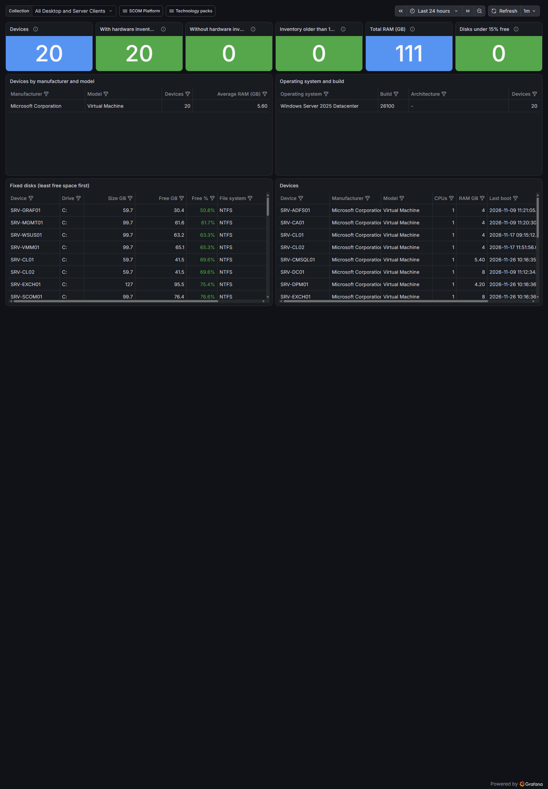
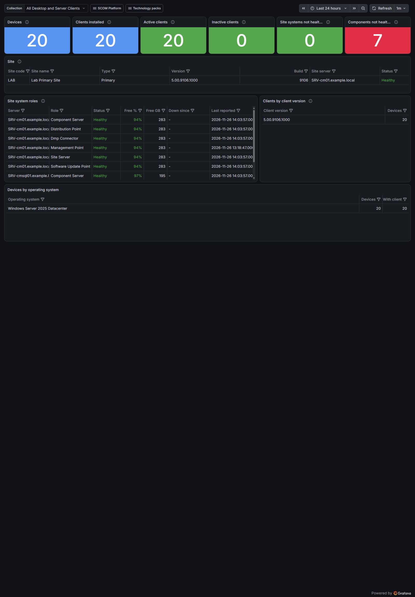
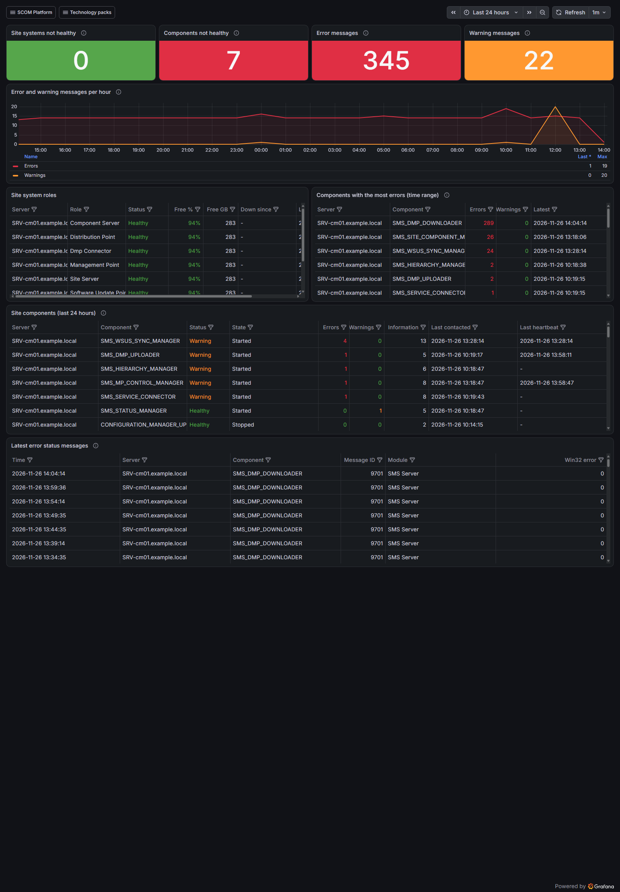
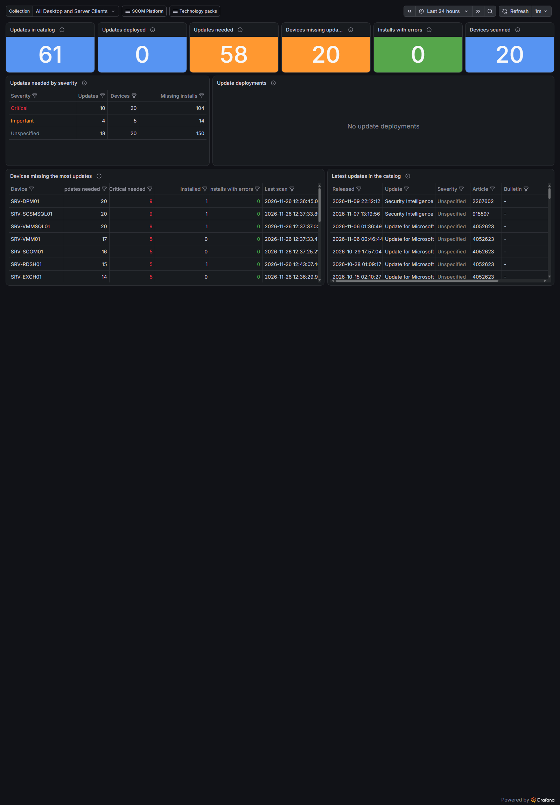

# SCCM (Configuration Manager)

Microsoft Configuration Manager from its own site database: clients and their health, site systems and components, software update compliance, application and task sequence deployments, and hardware inventory.

**Status:** validated against a real Configuration Manager site (version 5.00.9106). See [SCCM.md](../../docs/SCCM.md) for what was checked and what was not.

## Data source needed

- A **Microsoft SQL Server** data source in Grafana for the Configuration Manager site database (`CM_<site code>`) with a **read-only** login. The dashboards find it by name if it contains "SCCM", "ConfigMgr" or "Configuration Manager"; otherwise choose it in the **SCCM Database** drop-down.
- Nothing needs importing in SCOM. How to create the read-only login is in [SCCM.md](../../docs/SCCM.md).

## SCCM - Client Health

File: [`scom-cm-clients.json`](scom-cm-clients.json)

Panels: Active clients · Inactive clients · Clients failing health checks · Devices without a client · Client health by device (worst first)

## SCCM - Deployments

File: [`scom-cm-deployments.json`](scom-cm-deployments.json)

Panels: Deployments · Succeeded · In progress · Failed · Deployments with errors · Assignments · Deployments (most errors first) · Task sequence failures

## SCCM - Hardware Inventory

File: [`scom-cm-inventory.json`](scom-cm-inventory.json)

Panels: Devices · With hardware inventory · Without hardware inventory · Inventory older than 14 days · Total RAM (GB) · Disks under 15% free · Devices by manufacturer and model · Operating system and build · Fixed disks (least free space first)

## SCCM - Overview

File: [`scom-cm-overview.json`](scom-cm-overview.json)

Panels: Devices · Clients installed · Active clients · Inactive clients · Site systems not healthy · Components not healthy · Site · Site system roles · Clients by client version · Devices by operating system

## SCCM - Site Health

File: [`scom-cm-sitehealth.json`](scom-cm-sitehealth.json)

Panels: Site systems not healthy · Components not healthy · Error messages · Warning messages · Error and warning messages per hour · Site system roles · Components with the most errors (time range) · Site components (last 24 hours) · Latest error status messages

## SCCM - Software Updates

File: [`scom-cm-updates.json`](scom-cm-updates.json)

Panels: Updates in catalog · Updates deployed · Updates needed · Devices missing updates · Installs with errors · Devices scanned · Updates needed by severity · Update deployments · Devices missing the most updates · Latest updates in the catalog

## Known limits

- Tested on one primary site (version 5.00.9106) with 20 Windows Server 2025 clients. The client count, activity, client versions, site system roles, components, status messages, hardware inventory and software update scan results were shown from real data.
- **Deployments were not exercised.** The lab had no application, program, task sequence or software update deployments, so those panels open and show "No deployments". The failed task sequence step list is also untested.
- All lab clients were healthy and active, so Critical and Warning client rows have not been seen with real data.
- Not tested: a central administration site, secondary sites, internet-based and workgroup clients, large estates and query speed on a large database.
- Status message times follow the SQL Server clock; the lab ran on UTC.
- The numbers were read from the database views and not compared one by one with the Configuration Manager console.

## Import

*Dashboards → New → Import → Upload dashboard JSON file*, pick a folder, and import — the dashboard finds your SCOM SQL connections by name (or choose them from the two drop-downs at the top left). Import all folders at once with file provisioning: [INSTALLATION.md](../../docs/INSTALLATION.md). Screenshots are from a small test lab with server and domain names masked.
