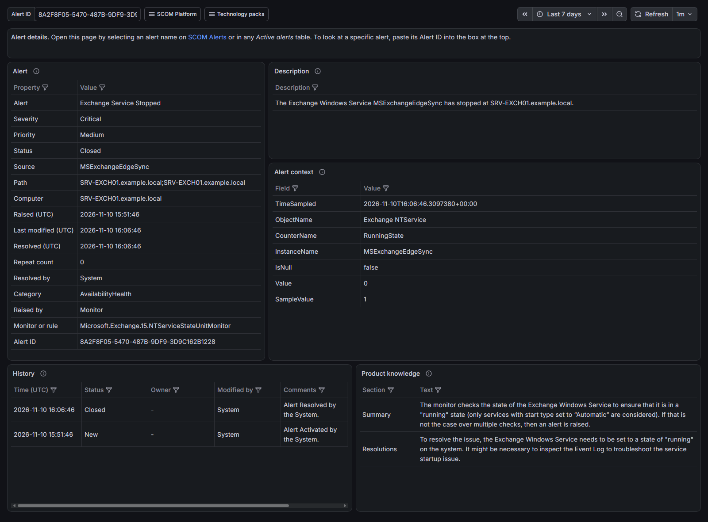
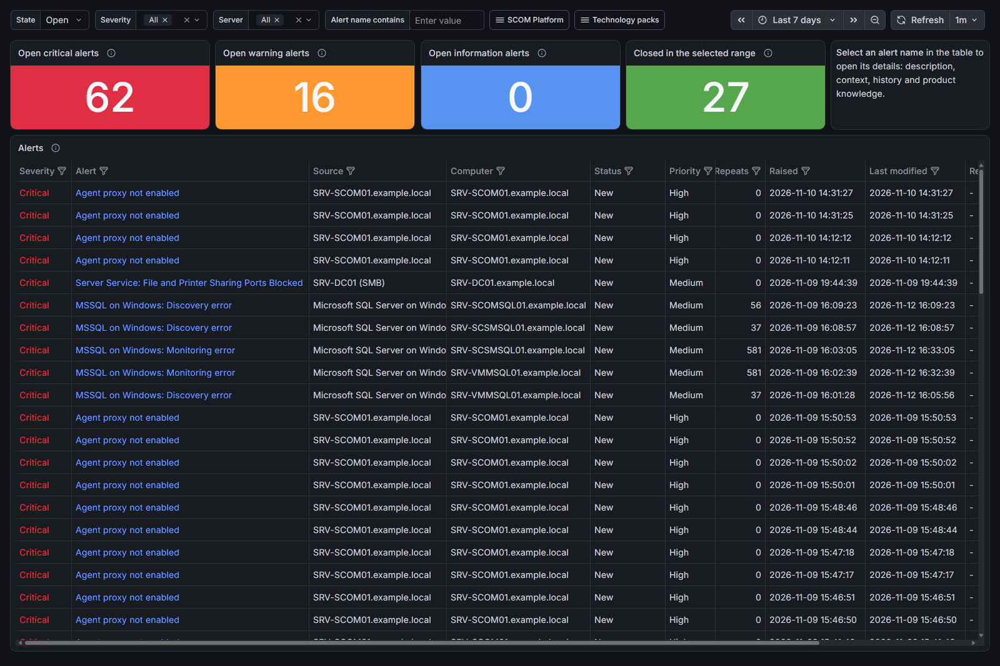
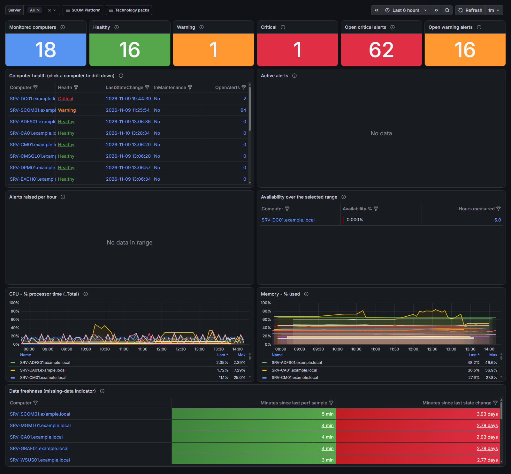
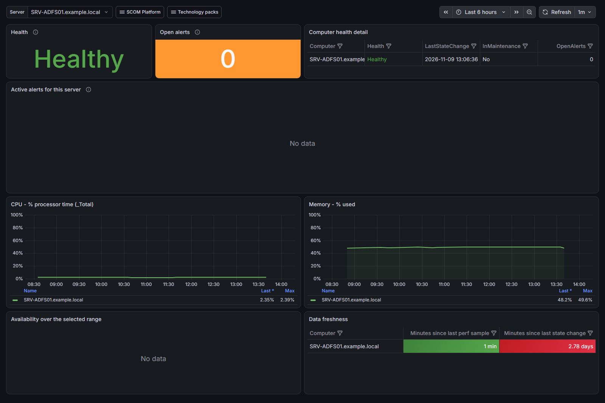
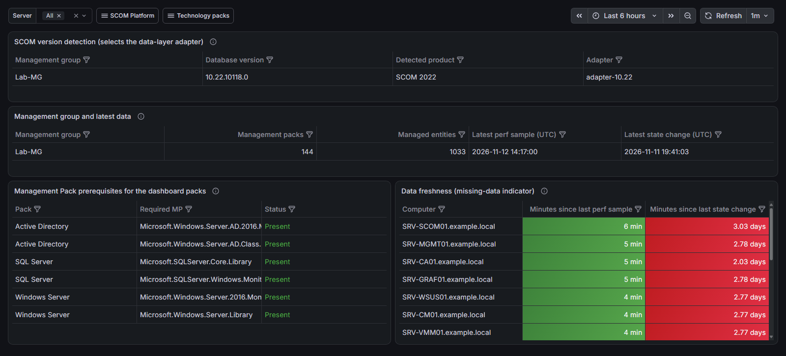

# SCOM Platform (core)

The enterprise overview (how healthy is the whole estate, what is alerting, is the data fresh), the full alerts page, and the alert details page (description, context, history and product knowledge). Start here. Every other dashboard links back to these, and every alert table links to the alert details.

**Status:** validated on SCOM 2022 against real data. See [PACKS.md](../../docs/PACKS.md) for what was checked.

## Management packs to import in SCOM

- None required. The Windows Server management pack is recommended so the overview has performance data to chart.

## SCOM Alert Details

File: [`scom-core-alert.json`](scom-core-alert.json)

Panels: Alert · Description · Alert context · History · Product knowledge

## SCOM Alerts

File: [`scom-core-alerts.json`](scom-core-alerts.json)

Panels: Open critical alerts · Open warning alerts · Open information alerts · Closed in the selected range · Alerts

## SCOM Enterprise Overview

File: [`scom-core-overview.json`](scom-core-overview.json)

Panels: Monitored computers · Healthy · Warning · Critical · Open critical alerts · Open warning alerts · Computer health (click a computer to drill down) · Active alerts · Alerts raised per hour · Availability over the selected range · CPU - % processor time (_Total) · Memory - % used · Data freshness (missing-data indicator)

## SCOM Server Drill-down

File: [`scom-core-server.json`](scom-core-server.json)

Panels: Health · Open alerts · Computer health detail · Active alerts for this server · CPU - % processor time (_Total) · Memory - % used · Availability over the selected range · Data freshness

## SCOM Platform Status

File: [`scom-core-status.json`](scom-core-status.json)

Panels: SCOM version detection (selects the data-layer adapter) · Management group and latest data · Management Pack prerequisites for the dashboard packs · Data freshness (missing-data indicator)

## Known limits

- Validated on SCOM 2022; 2019 and 2025 are expected to work but untested.

## Import

*Dashboards → New → Import → Upload dashboard JSON file*, pick a folder, and import — the dashboard finds your SCOM SQL connections by name (or choose them from the two drop-downs at the top left). Import all folders at once with file provisioning: [INSTALLATION.md](../../docs/INSTALLATION.md). Screenshots are from a small test lab with server and domain names masked.
