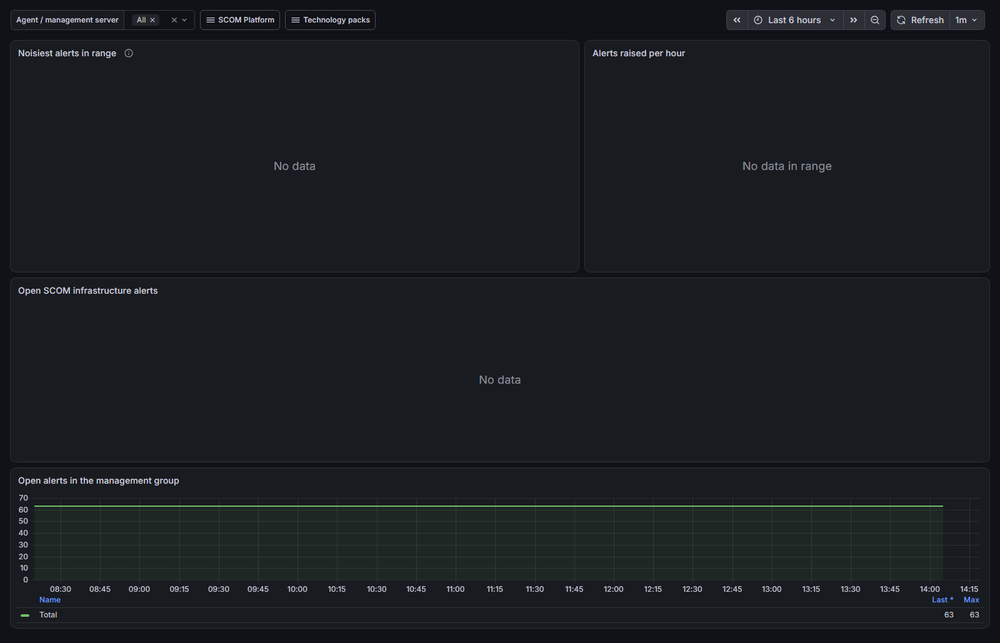
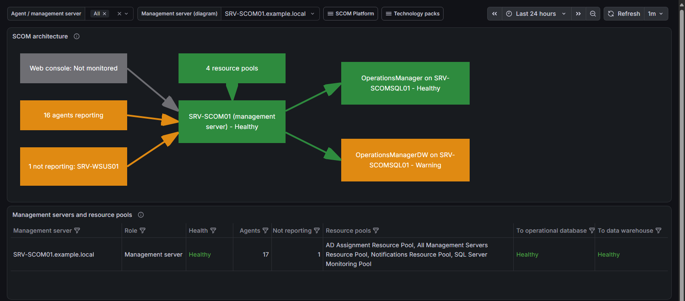

# SCOM Infrastructure

Health of SCOM itself: an architecture diagram of its components and the links between them, agents and their versions, heartbeat outages, management servers and which alerts are noisiest.

**Status:** validated on SCOM 2022 against real data. See [PACKS.md](../../docs/PACKS.md) for what was checked.

## Management packs to import in SCOM

- Built in to SCOM (Microsoft.SystemCenter.Library, Microsoft.SystemCenter.OperationsManager.Library). The diagram shows the database boxes in grey unless the SQL Server on Windows management pack is imported.

## SCOM Infrastructure - Agents

File: [`scom-infra-agents.json`](scom-infra-agents.json)

Panels: Agent inventory · Agent outages in range · Agent processor utilization (%) · Send queue - % used · Workflows running · Modules loaded

## SCOM Infrastructure - Alert Noise

File: [`scom-infra-alerts.json`](scom-infra-alerts.json)

Panels: Noisiest alerts in range · Alerts raised per hour · Open SCOM infrastructure alerts · Open alerts in the management group

## SCOM Infrastructure - Overview

File: [`scom-infra-overview.json`](scom-infra-overview.json)

Panels: SCOM architecture · Management servers and resource pools · Agents · Management servers · Healthy · Warning · Critical · Older than server · Proxy disabled · Open infra alerts · Management group · Agents and management servers · Unhealthy SCOM infrastructure monitors · Open SCOM infrastructure alerts · Agent outages in range · Agents by health state · Open alerts in the management group

## The SCOM architecture diagram

At the top of **SCOM Infrastructure - Overview**. Each box is a SCOM component coloured by its health (green healthy, amber warning, red critical, grey not monitored) and each line is a link coloured by the worst signal SCOM has for it. Choose the management server in the drop-down at the top.

Above, a lab server's SCOM agent has been stopped for several minutes: the agents link turns amber and the box names the missing agent. Under the diagram, a table lists **every** management server and gateway (health, agents, agents not reporting, resource pools and the state of its links to the operational database and data warehouse), so a second management server is visible even though the diagram draws the one chosen in the drop-down. What each line means:

- **Agents to management server:** the agent heartbeat. About five minutes after an agent stops reporting, SCOM turns its health Critical (and raises a heartbeat alert) or marks it unavailable, so an outage takes about that long to appear. Amber when some agents are missing, red when all are.
- **Management server to operational database:** the worst health of the Data Access service and the Configuration service. Stopping the Data Access service turned this line red in testing.
- **Management server to data warehouse:** the worst health of the data warehouse connector and the warehouse synchronisation service.
- **Resource pools and web console:** the health of the pool watchers and of the web console watcher. A line is grey when SCOM has no health signal for it.
- **Database boxes:** the health of the database as reported by the SQL Server on Windows management pack.

## Known limits

- Validated against one management server on SCOM 2022. With several management servers, the table under the diagram lists all of them and you choose the one to draw in the drop-down; this has not been tried with more than one management server. Gateways appear in the table but are not drawn, and the reporting server is not shown.
- Tested: an agent outage and a stopped Data Access service each changed the right box or line. Not tested: a failure of the data warehouse link, of a resource pool, or of the web console (the lab web console has no health data and shows grey).
- The diagram uses a fixed layout, so it assumes one management server with its database, data warehouse, agents and pools.

## Import

*Dashboards → New → Import → Upload dashboard JSON file*, pick a folder, and import — the dashboard finds your SCOM SQL connections by name (or choose them from the two drop-downs at the top left). Import all folders at once with file provisioning: [INSTALLATION.md](../../docs/INSTALLATION.md). Screenshots are from a small test lab with server and domain names masked.
