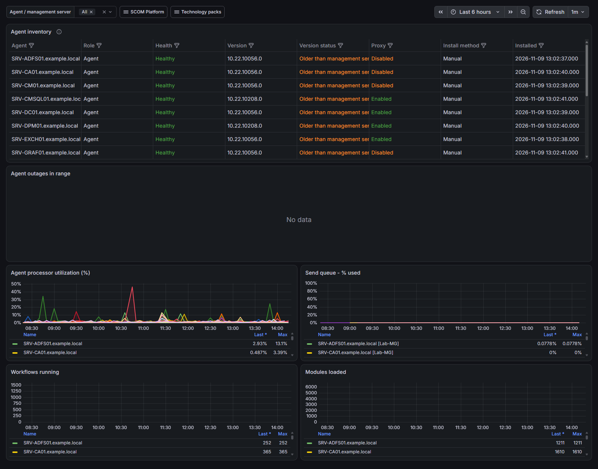
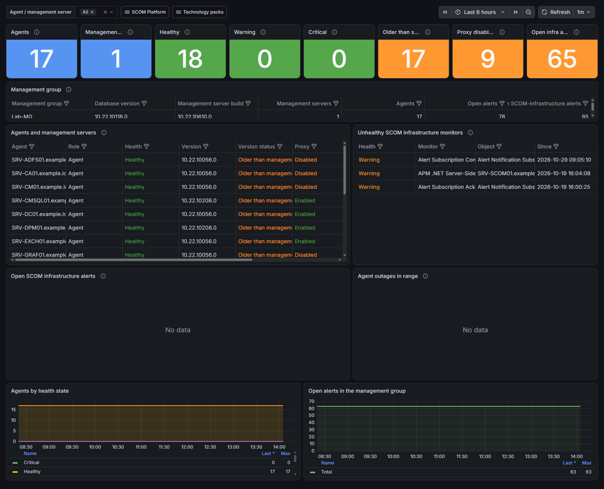

# SCOM Infrastructure

Health of SCOM itself: agents and their versions, heartbeat outages, management servers and which alerts are noisiest.

**Status:** validated on SCOM 2022 against real data. See [PACKS.md](../../docs/PACKS.md) for what was checked.

## Management packs to import in SCOM

- Built in to SCOM (Microsoft.SystemCenter.Library, Microsoft.SystemCenter.OperationsManager.Library).

## SCOM Infrastructure - Agents

File: [`scom-infra-agents.json`](scom-infra-agents.json)

Panels: Agent inventory · Agent outages in range · Agent processor utilization (%) · Send queue - % used · Workflows running · Modules loaded

## SCOM Infrastructure - Alert Noise

File: [`scom-infra-alerts.json`](scom-infra-alerts.json)

Panels: Noisiest alerts in range · Alerts raised per hour · Open SCOM infrastructure alerts · Open alerts in the management group

## SCOM Infrastructure - Overview

File: [`scom-infra-overview.json`](scom-infra-overview.json)

Panels: Agents · Management servers · Healthy · Warning · Critical · Older than server · Proxy disabled · Open infra alerts · Management group · Agents and management servers · Unhealthy SCOM infrastructure monitors · Open SCOM infrastructure alerts · Agent outages in range · Agents by health state · Open alerts in the management group

## Known limits

- Validated against one management server.

## Import

*Dashboards → New → Import → Upload dashboard JSON file*, pick a folder, and import — the dashboard finds your SCOM SQL connections by name (or choose them from the two drop-downs at the top left). Import all folders at once with file provisioning: [INSTALLATION.md](../../docs/INSTALLATION.md). Screenshots are from a small test lab with server and domain names masked.
