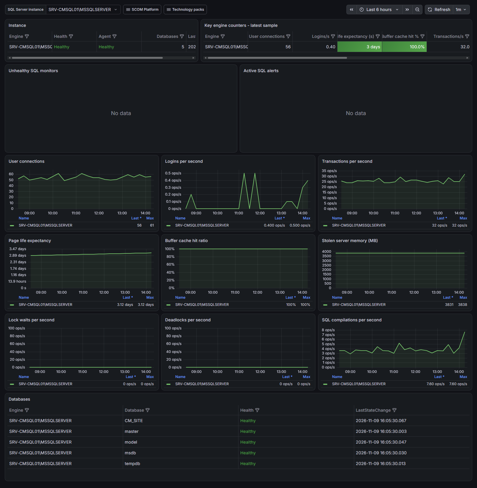
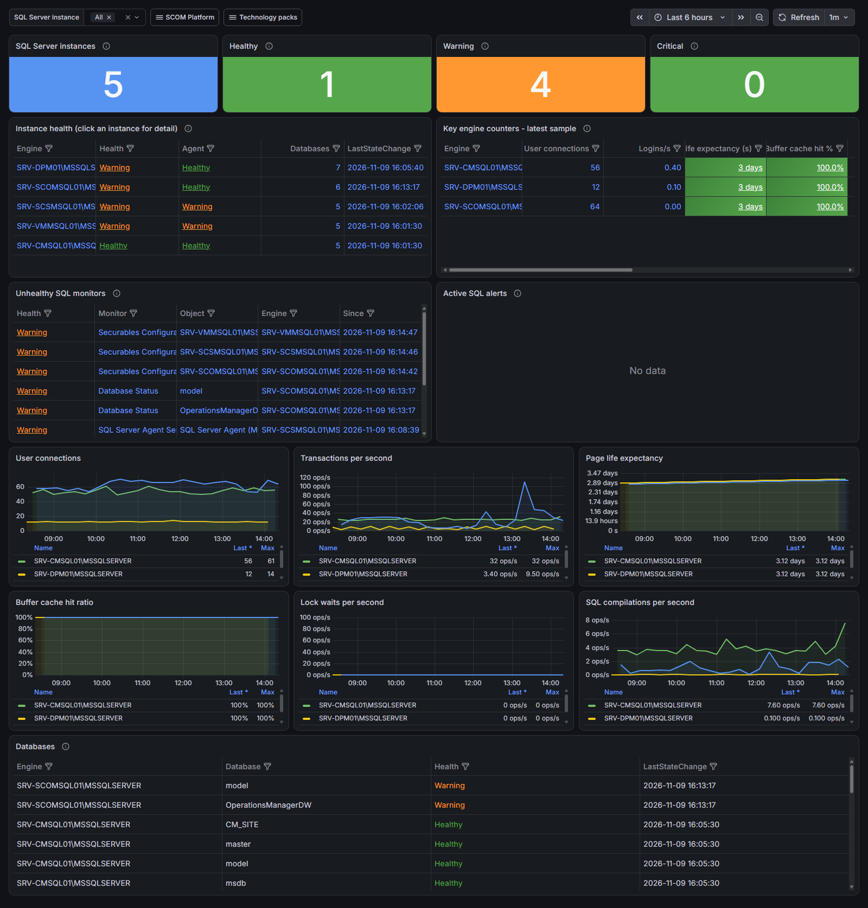

# SQL Server

SQL Server instance health, databases, agent status and the key engine counters (connections, transactions, page life expectancy, buffer cache, lock waits, compilations).

**Status:** validated on SCOM 2022 against real data. See [PACKS.md](../../docs/PACKS.md) for what was checked.

## Management packs to import in SCOM

- Microsoft.SQLServer.Core.Library
- Microsoft.SQLServer.Windows.Discovery
- Microsoft.SQLServer.Windows.Monitoring

## SQL Server - Instance Detail

File: [`scom-sql-detail.json`](scom-sql-detail.json)

Panels: Instance · Key engine counters - latest sample · Unhealthy SQL monitors · Active SQL alerts · User connections · Logins per second · Transactions per second · Page life expectancy · Buffer cache hit ratio · Stolen server memory (MB) · Lock waits per second · Deadlocks per second · SQL compilations per second · Databases

## SQL Server - Overview

File: [`scom-sql-overview.json`](scom-sql-overview.json)

Panels: SQL Server instances · Healthy · Warning · Critical · Instance health (click an instance for detail) · Key engine counters - latest sample · Unhealthy SQL monitors · Active SQL alerts · User connections · Transactions per second · Page life expectancy · Buffer cache hit ratio · Lock waits per second · SQL compilations per second · Databases

## Known limits

- Needs agent proxy enabled on the SQL Server agents, otherwise SCOM does not discover the instances.
- SQL Server on Linux, Always On and replication were not exercised.

## Import

*Dashboards → New → Import → Upload dashboard JSON file*, pick a folder, and import — the dashboard finds your SCOM SQL connections by name (or choose them from the two drop-downs at the top left). Import all folders at once with file provisioning: [INSTALLATION.md](../../docs/INSTALLATION.md). Screenshots are from a small test lab with server and domain names masked.
