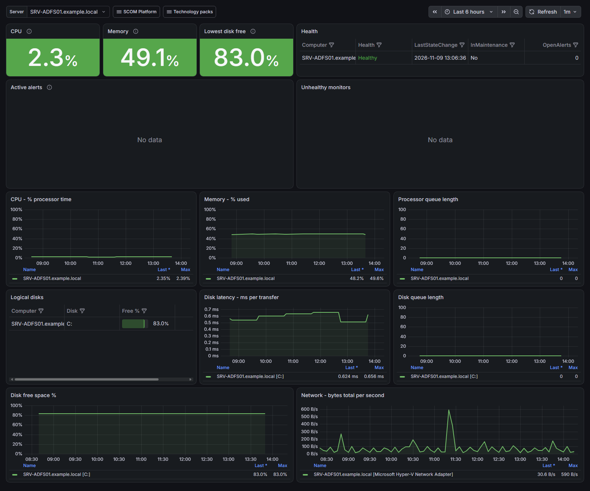
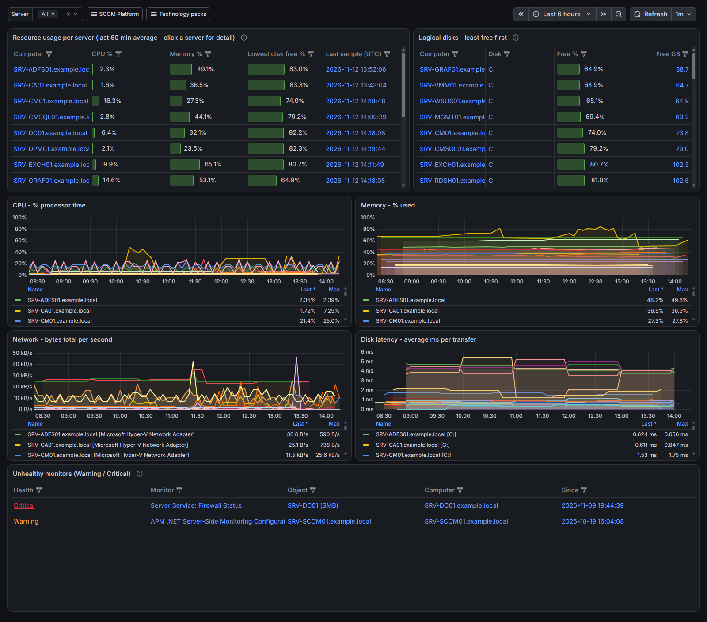

# Windows Server

Fleet view of every monitored Windows server (CPU, memory, disk space, network, disk latency) with a drill-down to a single server.

**Status:** validated on SCOM 2022 against real data. See [PACKS.md](../../docs/PACKS.md) for what was checked.

## Management packs to import in SCOM

- Microsoft.Windows.Server.Library
- Microsoft.Windows.Server.2016.Monitoring

## Windows Server - Detail

File: [`scom-ws-detail.json`](scom-ws-detail.json)

Panels: CPU · Memory · Lowest disk free · Health · Active alerts · Unhealthy monitors · CPU - % processor time · Memory - % used · Processor queue length · Logical disks · Disk latency - ms per transfer · Disk queue length · Disk free space % · Network - bytes total per second

## Windows Server - Fleet

File: [`scom-ws-fleet.json`](scom-ws-fleet.json)

Panels: Resource usage per server (last 60 min average - click a server for detail) · Logical disks - least free first · CPU - % processor time · Memory - % used · Network - bytes total per second · Disk latency - average ms per transfer · Unhealthy monitors (Warning / Critical)

## Known limits

- Performance counters use SCOM optimized collection, so quiet counters have long gaps between stored samples. Charts connect gaps of up to 65 minutes.

## Import

*Dashboards → New → Import → Upload dashboard JSON file*, pick a folder, and import — the dashboard finds your SCOM SQL connections by name (or choose them from the two drop-downs at the top left). Import all folders at once with file provisioning: [INSTALLATION.md](../../docs/INSTALLATION.md). Screenshots are from a small test lab with server and domain names masked.
